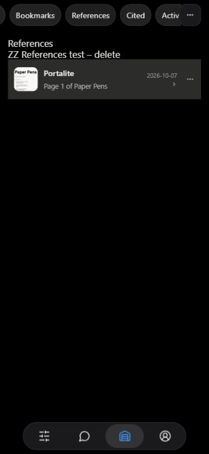
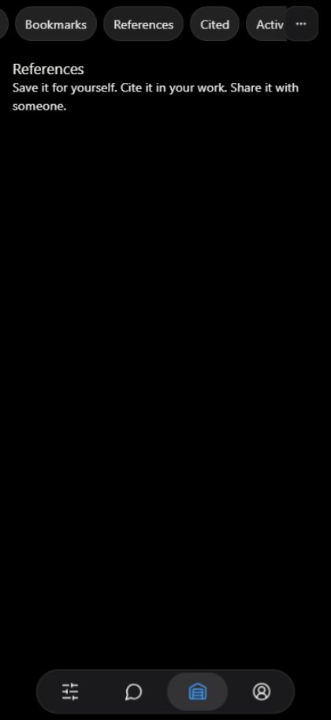

# Citation acceptance — current result, 7 October 2026

Production migrations0001/0002/0003 are applied and stored under supabase/migrations. No SQL is pending in this change and none should be rerun. The application source remains unpublished. The real citation lifecycle and Studio References fix are verified below; historical notes after this summary retain their original dates/status and are superseded where applicable.

- Actual signed-in citetest → Portalite image13 citation saved, populated project References, then published metadata-only test project. Exactly one deferred notification verified in the recipient database rows; recipient inbox UI was not manually inspected.
- Deleted test project9d66bf12-4363-4b33-8218-b84b3d792276; citation3315ac8d-811b-40b1-a0ab-919de0fdc156 and notification6578cb37-74b8-482a-87b5-2d7766458760 cascaded away, public Cited-in count disappeared.
- Studio References PGRST201 fixed by explicit projects_profile_id_fkey creator join. Actual citetest citation to Paper Pens page1 populated Studio at420×912; after approved deletion, real empty state returned. Removed project29ab558e-7360-4933-b1be-8c3dd22fe40a and citationa0582caf-f012-4b18-98a5-202d8bb143a9; original page1b5e9529-f180-4632-a9fd-c87428472e5a retained. No notification created by this hidden fixture.
- UUID image /cite route and single-page PDF fallback observed against live production data through the unpublished local preview. Canonical citation URL uses the production host. No new Storage policy, object write, worker deployment or D1 change.
- All Portalite16projects/8portals retained. citetest has no projects and retains its own Work portal. Full inventory: [owner inventory](citation-owner-inventory-20261007.md).
- Evidence is viewport emulation, not physical-device proof. Metadata-only fixtures avoid uploads and do not prove the complete new-project Files upload flow. Deployed Site route has not been upgraded. These practical limits remain even though the requested citation lifecycle passed.

Other evidence: [Cite saved](evidence/citations-20261007/live-cite-saved.png), [project References](evidence/citations-20261007/live-project-references.png), [Cited in1project](evidence/citations-20261007/live-cited-in-one.png), [UUID image](evidence/citations-20261007/image-uuid-resolver.png), [document page](evidence/citations-20261007/document-page-render.png).

## Historical acceptance notes
## 2026-10-07 — References loading fixed and real-page fixture removed

Supersedes cleanup-pending note below. User confirmed exact permanent deletion. App deleted project29ab558e-7360-4933-b1be-8c3dd22fe40a (ZZ References test – delete), cascading citationa0582caf-f012-4b18-98a5-202d8bb143a9. Final read-only receipt: project0, citation0, notification0, originalpage1, Portaliteprojects16, Portaliteportals8, citetestprojects0. First verification raced ongoing app deletion and saw1/1; after app displayed No projects in Work, same SELECT returned0/0. No manual delete SQL or rerun mutation. Test never published, no notification created, no attachments/Storage/D1 rows. Existing citetest Workportal retained.

Fixed creator join in citationProject: profiles!projects_profile_id_fkey(name), live PGRST201 ambiguity with reverse profiles_start_here_project_fkey proven. Real Paper Pens page1 citation saved through app and populated StudioReferences at420x912 after correction; cleanup returns actual empty state. Added tests/citation-project-reader.test.mjs covering live-schema ambiguity and unavailable project. Five focused Node/PGlite/UI tests pass, typecheck and diff-check pass. Temporary diagnostics removed. No WEB Studio availability change, no unrelated edits, no main reconciliation or publish. Exact owner inventory in docs/citation-owner-inventory-20261007.md.

Screenshots logs/citation-acceptance/studio-references-real-empty.png and studio-references-real-populated.png. Source changes limited this turn to service.ts join, new regression test, inventory doc and handoff. Branch codex/citation-foundation HEAD07ca5f5 unchanged. All source remains uncommitted/unpublished; migration0003 unchanged in migrations, no SQL schema/application performed this turn.
## 2026-10-07 — live citation lifecycle cleaned; 0003 moved, no publish

Task worktree logs/citation-foundation, branch codex/citation-foundation, HEAD07ca5f5 unchanged. User signed into unpublished production-connected preview5193 as citetest (profile21859add-dfa8-4241-8ec8-8a5256f1ab23, generated handle citetes.d9ab049b2da4). Created metadata-only private project ZZ test – delete by approved SQL; saved real citation through signed-in Cite UI. References rendered actual stickerbomb / Portalite / Image13 row. Private insertion produced zero notifications and public Cited-in []; Make visible through app created exactly one deferred notification and public Cited in1project. Notification verified by production database recipient row, not recipient UI session.

Created then removed: project9d66bf12-4363-4b33-8218-b84b3d792276; citation3315ac8d-811b-40b1-a0ab-919de0fdc156 (source app, note null, target image9ae4b24a-446d-41b8-b3a9-1a035ed14fc7); notification6578cb37-74b8-482a-87b5-2d7766458760, recipient Portalite accountbb369011-8125-4d20-af08-10fad0eb2d80. User confirmed exact permanent deletion at action time. App Delete project completed; scoped production SELECT confirms all three IDs count0 and public_cited_in=[]; refreshed image route has no Cited-in count. Test had no attachments, Storage or D1 rows. User-created citetest Auth/profile/Work portal7f3cc9d2-41ed-4738-aeeb-fe62baa49990 retained.

Portalite inventory after cleanup retains all ten document titles from citation-rendering-inventory-20261007.md. Actual full database inventory is16 projects and8 portals, all non-hidden (not ten total/seven total). Only deletion targeted the other creator's exact test UUID; no original project/portal writes made. Read-only inventory query first used nonexistent portal name and failed, then corrected to IDs/hidden and succeeded; no schema/migration changed.

0003 moved byte-for-byte from pending to supabase/migrations; SHA25686CCD769E61309FEBB97404805C09CBA97C23424E3E2C5DD87516B421CDFA4C2 unchanged. Applied previously once; no rerun or CLI ledger repair. Database fixture path updated. Small Cited-in singular copy correction in CitationReferences.tsx. 30 focused Node/PGlite checks pass, none skipped. Typecheck passes; git diff --check passes. No Site publication, merge, Storage change or worker deploy.

Evidence logs/citation-acceptance/live-{cite-saved,project-references,cited-in-one,notification-once,cleanup-receipt,image-after-cleanup}.png. Image UUID route verified against live production DB through unpublished preview; deployed app route not upgraded. Metadata-only fixture avoids upload and does not establish complete Files-to-publish upload acceptance. Studio References showed Citations could not be loaded at420x912; unresolved acceptance issue, do not report release-ready. Recipient inbox UI, full Studio/Journey populated layouts and physical phone remain unverified.
# Citation fixes — acceptance evidence, 7 October 2026

Unpublished task branch `codex/citation-foundation`, based on published source `07ca5f5`. Production migrations 0001 and 0002 are already applied. **0003 remains pending review, unapplied, and must not be moved yet.** No Site publication, worker deployment, Storage policy change, or Storage upload occurred during these checks.

## Pending database change

`supabase/pending/202610070003_opaque_image_citations.sql` adds immutable attachment citation UUIDs, translates existing image citation records, replaces image resolver/target/view paths, and preserves page UUIDs. Existing attachment IDs and storage paths remain unchanged. Old path-shaped citation IDs stop resolving.

It also fixes the live `notifications_kind_check`: the catalog permits message/reply/follow/system but rejects citation. A signed-in citation attempt rolled back with “Citation could not be saved”; no citation or notification persisted. The revised constraint preserves every existing kind and adds citation. Finally, an atomic publishing wrapper sets access and made-on date in the creation transaction, preventing a private project's temporary public exposure. These additions need review alongside the UUID migration.

## Results and limits

| Check | Result |
| --- | --- |
| Single document page without renderedPages | Paper Pens page 1 and Living Roof Systems page 7 rendered actual PDF canvases through existing signed/multipart/pdf.js paths. No new Storage policy. |
| Render failure fallback | Stored cover plus page number and unavailable label verified. |
| Canonical citation URL | Production host shown in the unpublished local resolver. Optional non-secret VITE_PUBLIC_ORIGIN config must be HTTPS and cannot be localhost; default is the existing production host. |
| Image UUID backfill, stability, cleanup | Passed isolated PGlite tests. Live UUID route cannot be checked until 0003 is approved/applied. |
| New-project mobile fields | Private, Public, Citable and Made on visible at 420 × 912; Description and bottom actions fit. A reference image was staged locally only. No upload or project publication. Backend wrapper remains pending live verification. |
| Signed-in Cite sheet | Existing own-project list loaded for another creator's page; New project opened the Files flow. |
| Citation save / populated project References | Blocked by live notification check constraint. No fabricated reference rows or successful-save screenshot. |
| Studio Cited / References | Real signed-in empty views captured; selected pills stay visible. At 390px Activity collapses into All; References and Cited remain. |
| Deferred notification | Hidden insertion → publish notification passes PGlite. Live acceptance awaits pending constraint repair and a real saved citation. |
| Like removal | Rendered EngagementBar variants tested without Like or like count; no exhaustive manual audit of every route claimed. |

All ten Portalite document projects have covers and zero renderedPages; [inventory](<C:/Users/avima/OneDrive/Desktop/Portalink Platform/logs/citation-foundation/docs/citation-rendering-inventory-20261007.md>) records their known/unknown page counts. The existing PDF worker is the proper long-term pre-rendering mechanism, with queue/backfill and attachment metadata completion still requiring verification and separate deployment/Storage approval.

Focused Node/PGlite suite: **30 passed, none skipped**. Typecheck and build pass. Lint: zero errors, 110 warnings. Citation entry keeps the editor/appearance chunks out of its initial graph and loads PDF rendering lazily. Physical-phone testing and the atomic publishing wrapper's live execution remain unverified.

## Screenshots

Actual PDF page and production-host citation:

Mobile creation fields (Citable):

Private / Public:

Signed-in Cite sheet and failed save:

Studio's real empty states:

Screenshot files are local ignored evidence, not packaged application assets. A populated References screenshot and live deferred-notification proof remain outstanding until 0003 review/application. Still no publish.
