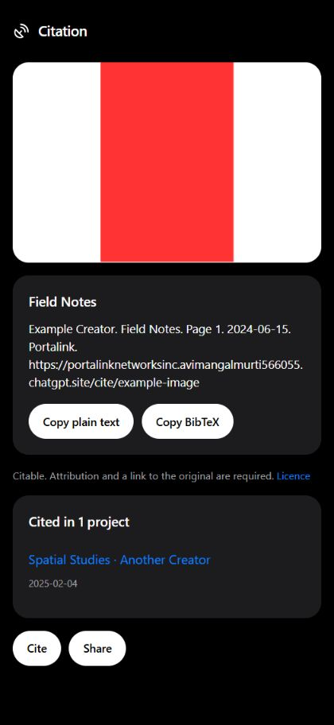
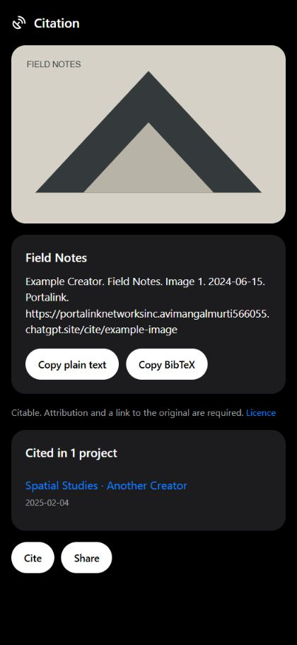
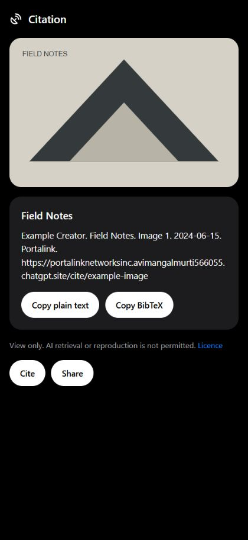
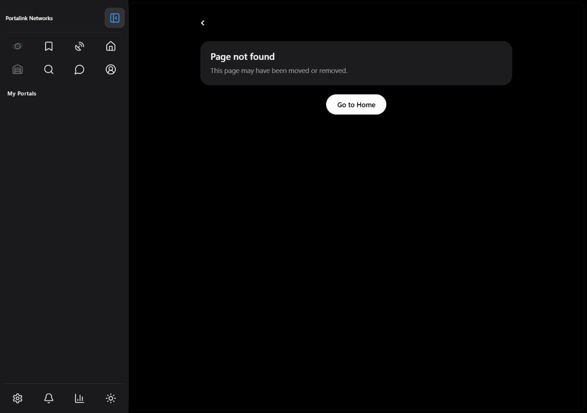
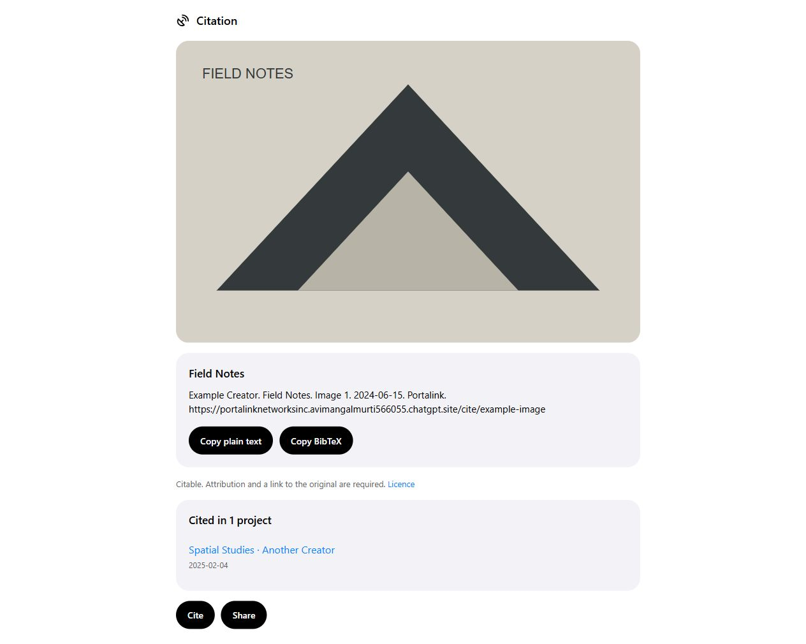
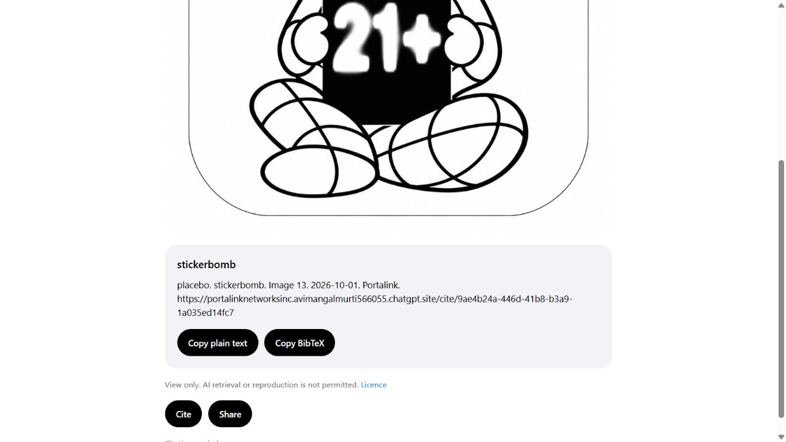

# Citation cards and route errors

Captured from the real application/components before merge at 420 × 912 CSS pixels unless identified as desktop. Most records use synthetic, page-local read services; the connected public image uses the existing production backend anonymously. No account, citation, profile or SQL writes were performed. Expired/no-access screenshots exercise the shared component directly because no disposable expired public link was available. PDF screenshot uses the repository PDF fixture. These are browser previews, not physical iPhone testing.

## Image, default dark

## Real PDF page renderer, synthetic citation

## Citable item with a non-empty cited-in card

## View-only item, no empty cited-in card

## Not found

## Network error

## Expired link component

## No access component

## Signed-in app shell with the existing mobile dock

## Signed-out app shell without a dock

## Desktop app shell

## Creator light appearance on desktop

## Connected public image, actual creator appearance

