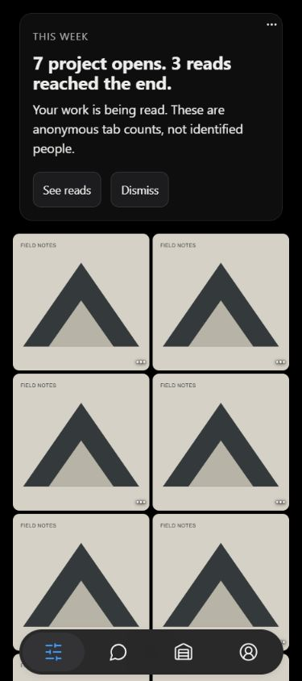
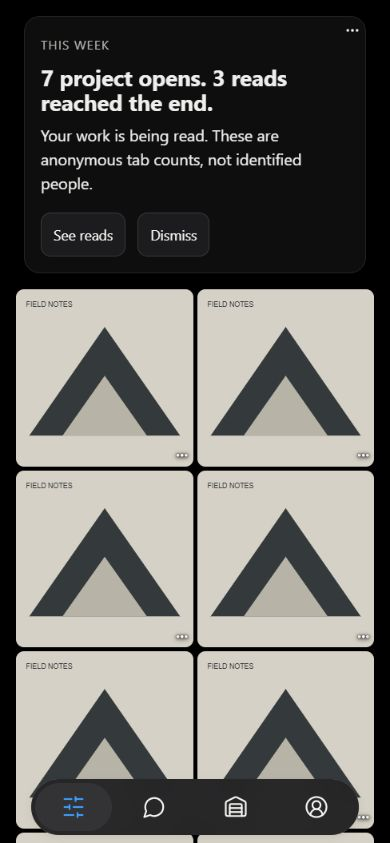
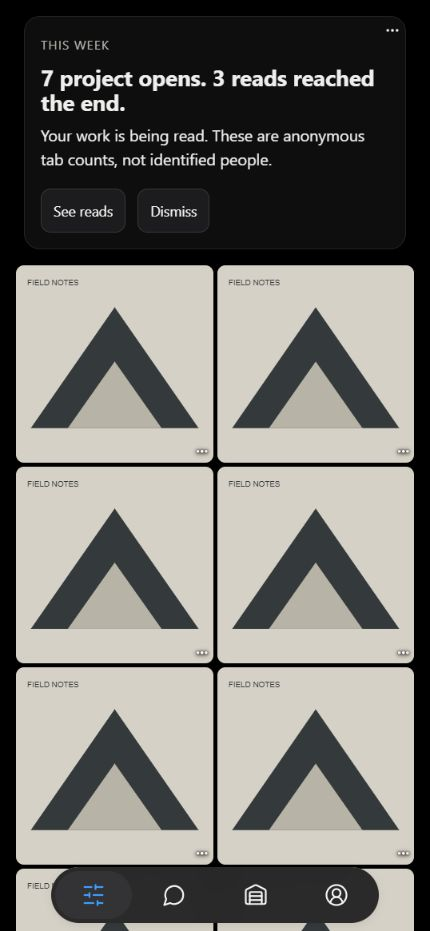
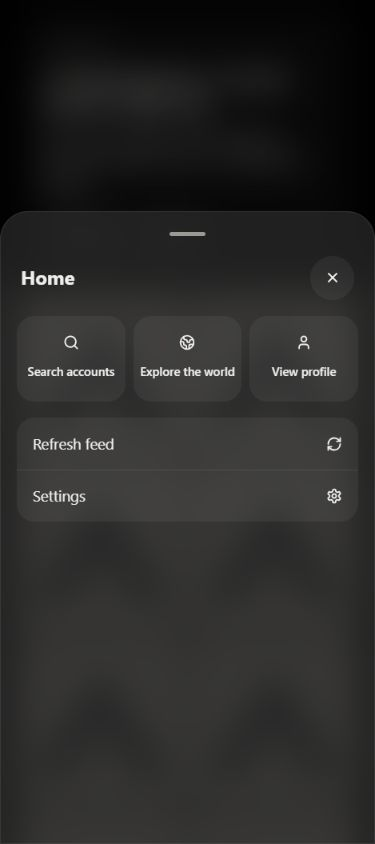
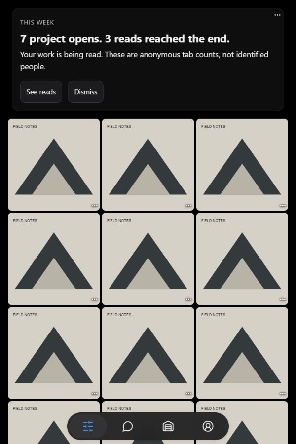
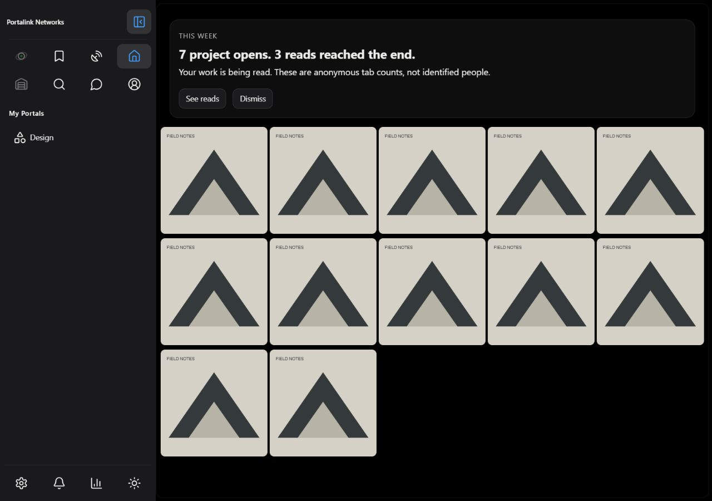

# Home browser evidence — 2026-10-12

Captured from the real local app at port 5200, using synthetic page-local account, projects and reads services. The artwork and weekly counts are fixtures, not production data. No production account or content was changed. These screenshots show MOBILE Home conformance; desktop and other screens remain intact.

| Viewport | Document scroll width | Columns | Artwork gutter | Dock |
| --- | --- | --- | --- | --- |
| 375px | 375px | 2 | 16px CSS | present |
| 390px | 390px | 2 | 16px CSS | present |
| 430px | 430px | 2 | 16px CSS | present |

## 375px

## 390px

## 430px

## Home Actions

Moved entries and View profile are available through the normal Actions sheet.

## Saved columns when they fit

At 600px, three saved columns fit. Responsive fallback does not overwrite the saved preference.

## Desktop preservation

1280px Home retains the saved five-column layout. Document scroll width is 1280px; clean-tab runtime error log is empty.

Pull-to-refresh was checked using native synthetic TouchEvents bubbling from an artwork button through the actual Home component: a valid pull increased the mocked discovery-request count from 1 to 2 and kept all twelve cards; short pulls and pinches left it at 1. Unit checks also cover scroll position, busy feeds, cancellation, withdrawing a pull and listener cleanup. This is browser/fixture evidence, not physical iPhone verification.

No merge or publication has occurred.
