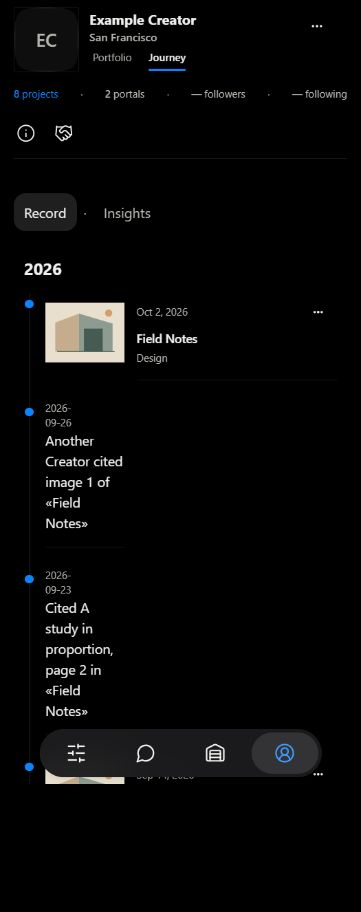
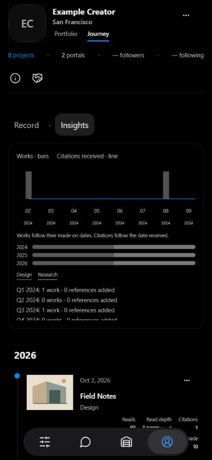
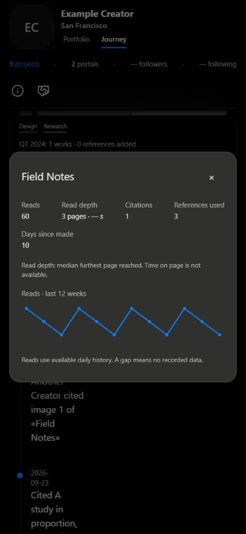
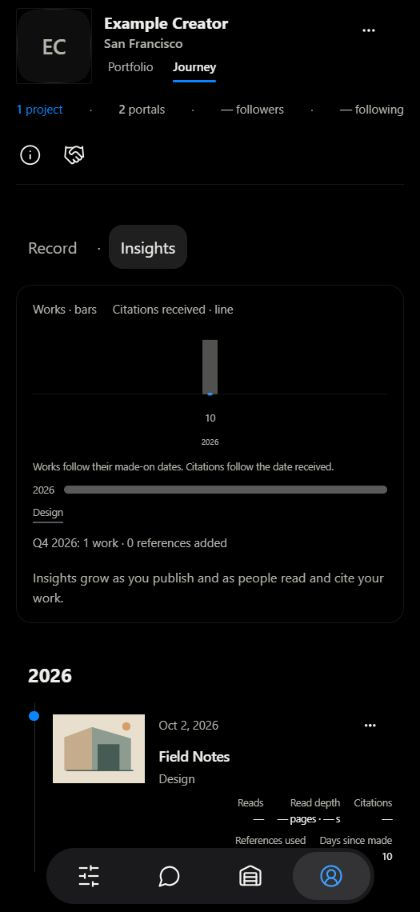
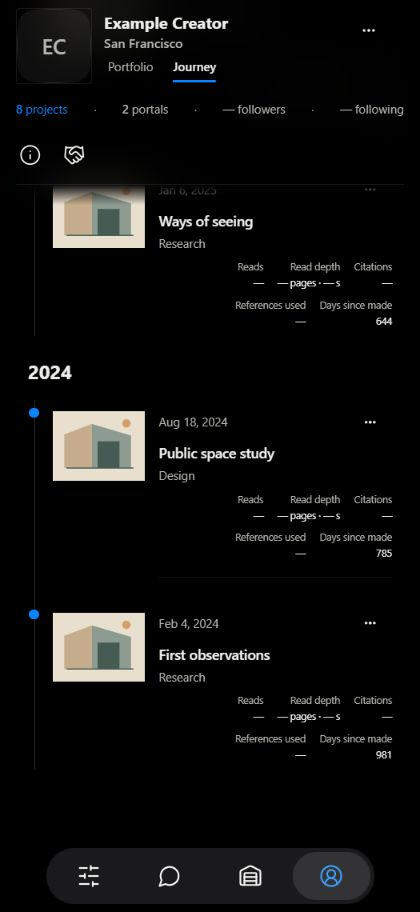
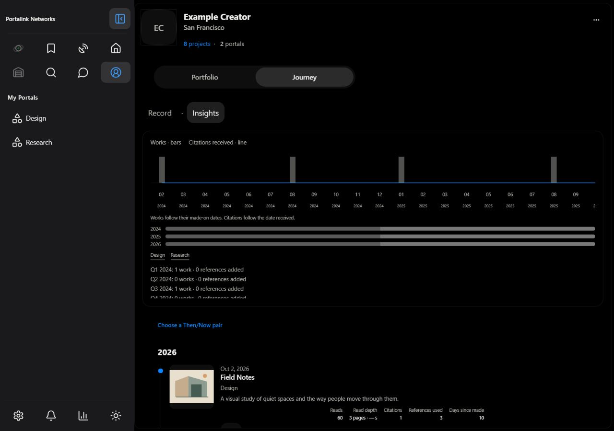
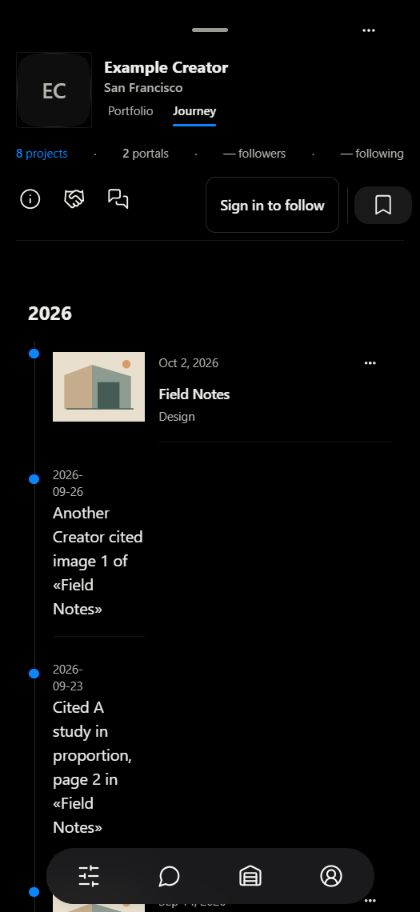

# Journey Insights screenshots

Real app root and components with **synthetic test account, projects and data**;
no production analytics or account writes. Mobile viewport 420×912 CSS pixels.
The existing timeline and public surfaces are preserved; these are browser
captures, not physical-device or deployed-API evidence.

## Record (default)

## Insights

[Complete Insights timeline](insights-full.jpg) includes all years and rows.

## Row tap

## Brand-new creator / one work

## Additional checks

Time on page is deliberately “—”: existing RUM measures loading speed. Read
depth is median furthest page reached, explained in the card. The API reads
existing daily rollups and does not fabricate missing history.
