# Owner profile conformance browser evidence — 2026-10-12

Real app components at localhost5201, using isolated page-local synthetic account/content services. App theme is dark with blue accent; public appearance is light with green accent for the same creator. No production account or content writes. Primary mobile viewport420x912; desktop1280x900. No physical iPhone verification claimed.

## Owner Journey and Actions

Journey starts selected. App theme, dock and one standard monochrome Actions button. No standalone magenta control.

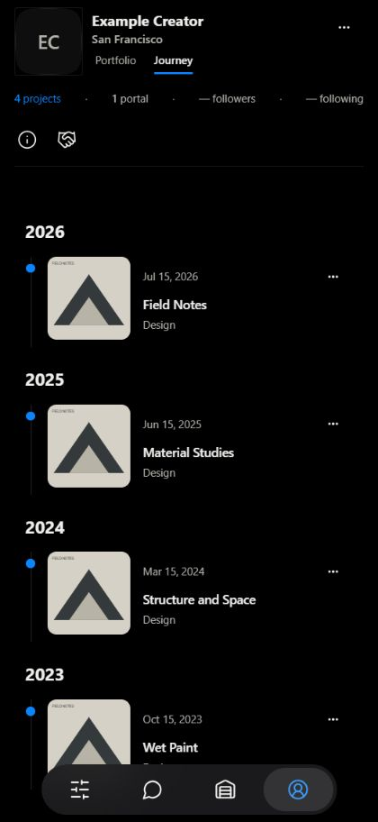

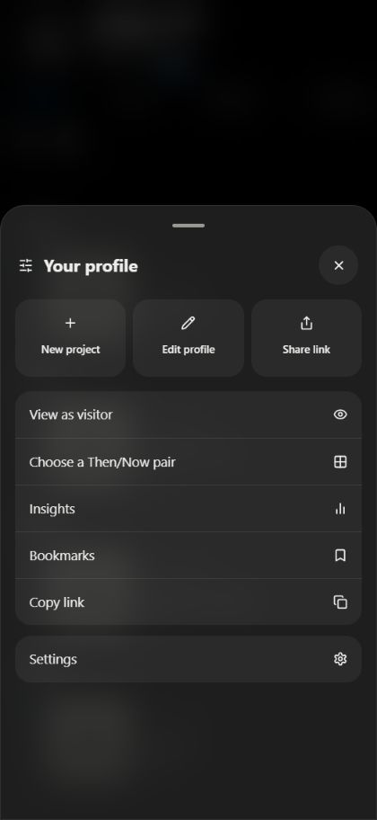

## Owner reader and relocated actions

Bottom list/ellipsis/person pill removed. Counter and slider retained. Actions contains Open portal, Project information and View profile; opening information uses the existing sheet.

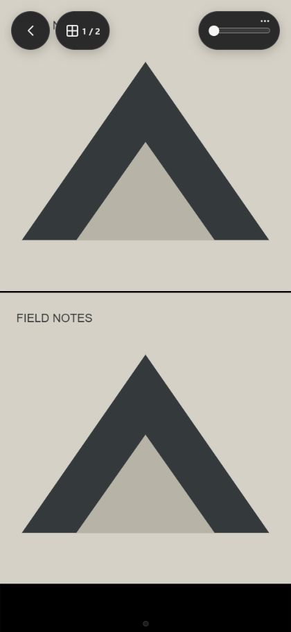

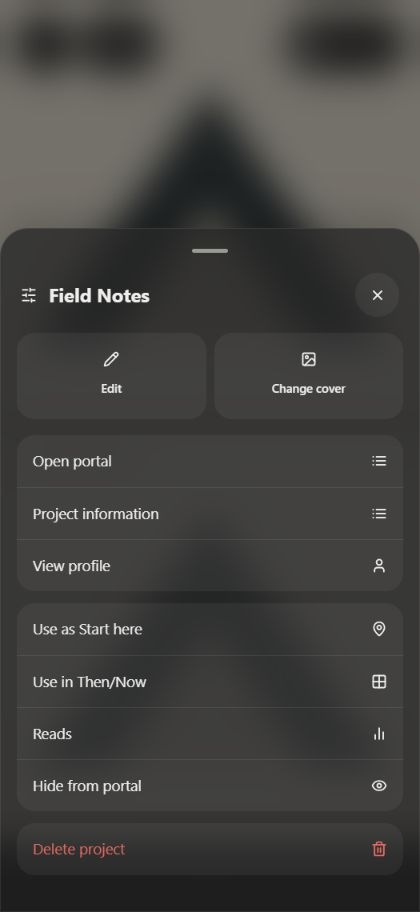

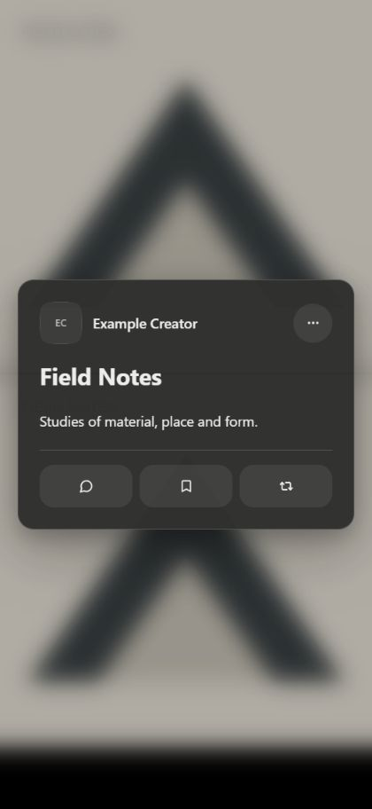

## View as visitor

Actual owner Actions entry opens public light/green appearance, no owner tools or dock, with Done bar. Done was clicked and returned to dark owner Journey with dock.

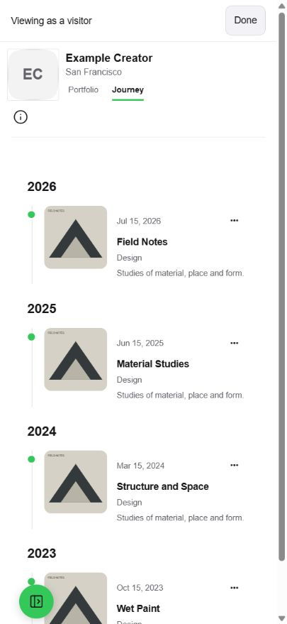

## Normal public profile and reader

Only the requested default Journey selection changes. Normal public styling and reader bar/counter/slider remain; no preview bar appears. Portfolio is one tap away.

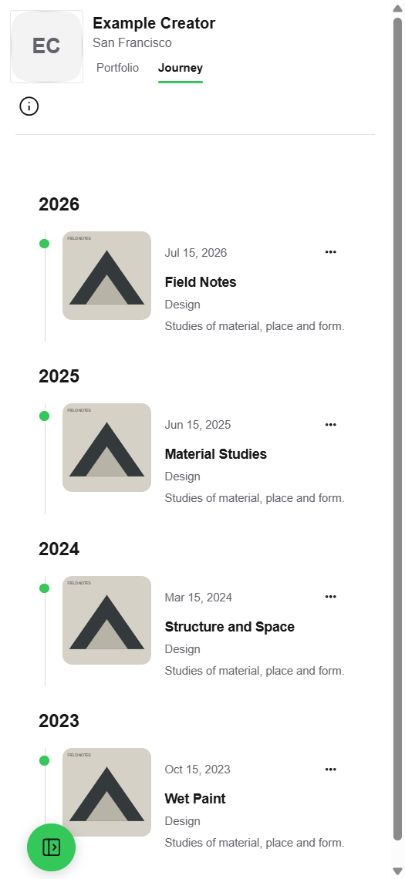

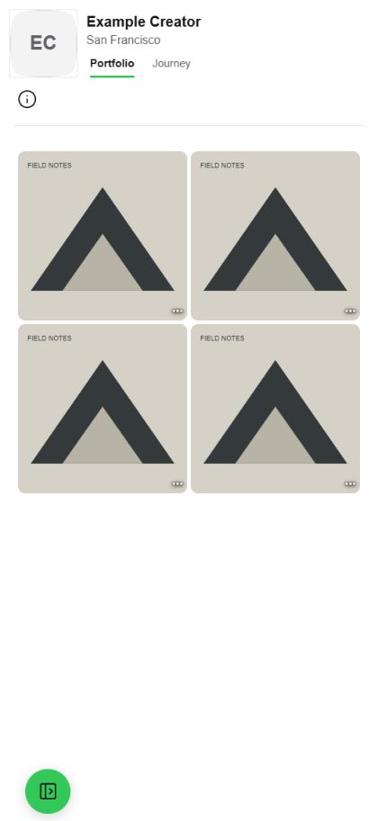

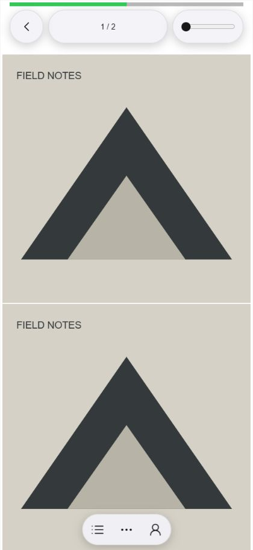

## Desktop preservation

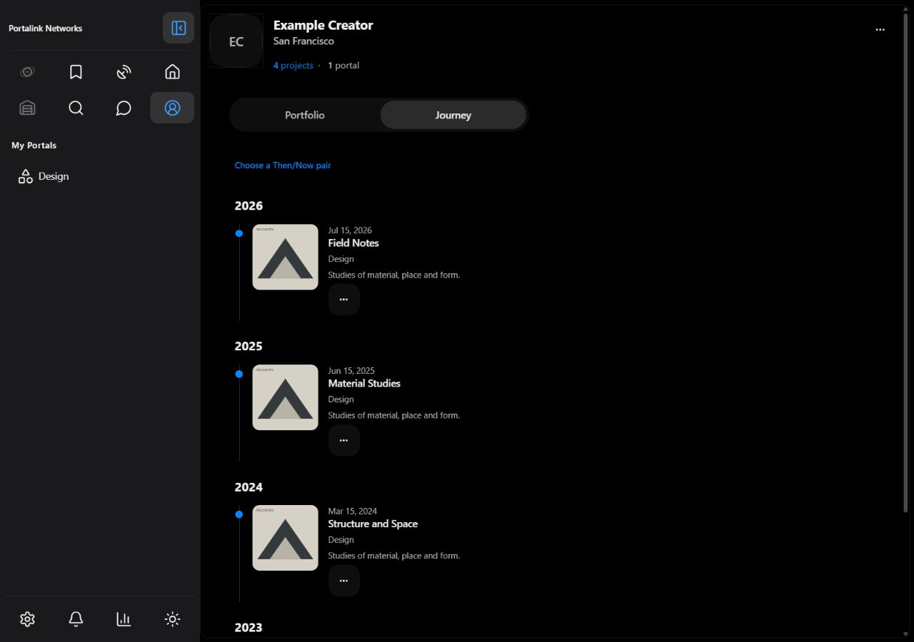

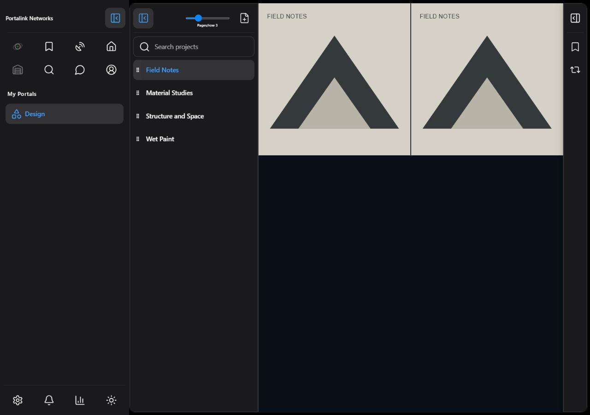

## Color checks

[Owner interface computed colors](owner-profile-colors.json) and [visitor reader color audit](visitor-reader-colors.json): zero saturated UI colors outside chosen blue/green. Audit reads computed text/background/border colors; saturated means chroma>=64 and chroma/max>=0.5, with a0.07 hue tolerance for derived chosen-accent tokens. Artwork is not recolored; status/destructive semantics remain unchanged. Standard Actions uses theme text and transparent background.

All screenshots precede merge. No merge/publication has occurred.
