# References and exports — app screenshots

Captured from the **real app root and components** in a localhost QA harness,
with synthetic account/project services and transport. No production reference
rows were written. Mobile screenshots use 420 × 912 CSS pixels; desktop uses
1280 × 900. Additional 390/430 phone-width checks showed no horizontal overflow.
This is browser evidence, not physical-phone or production integration testing.

## Studio Overview

Recent draft:

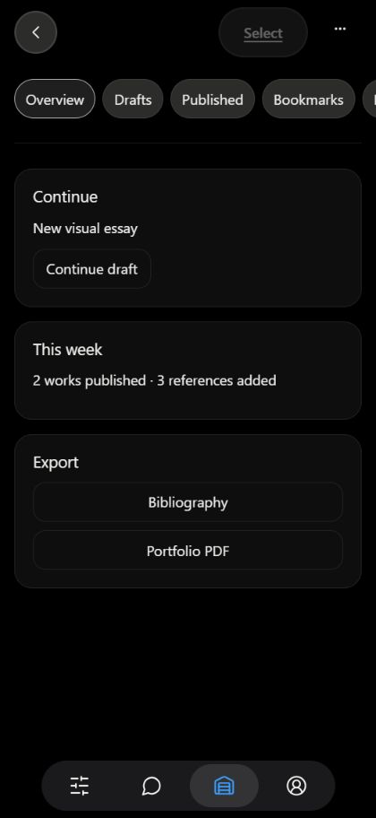

No draft:

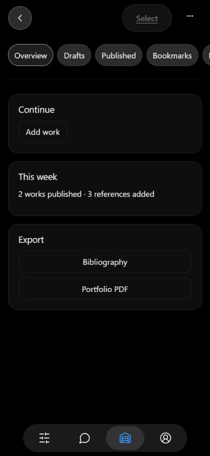

## References and confirmation

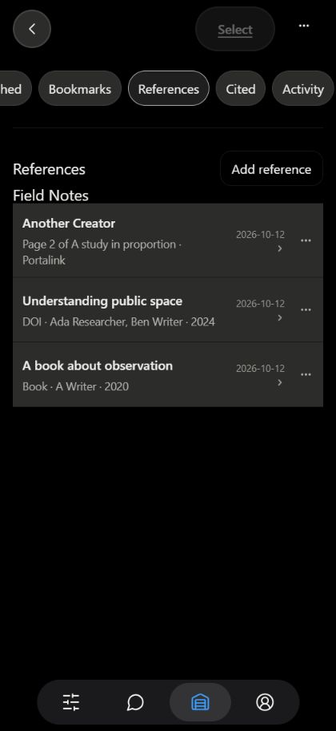

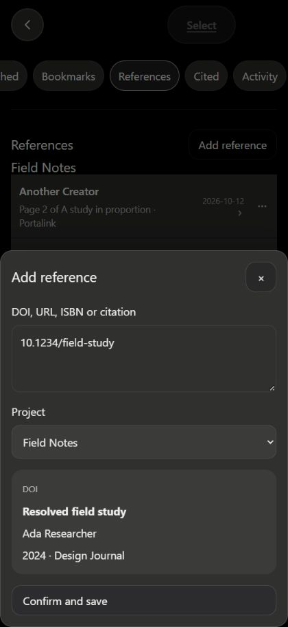

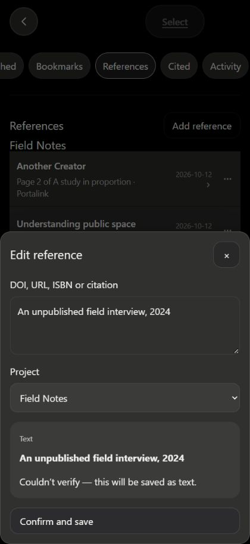

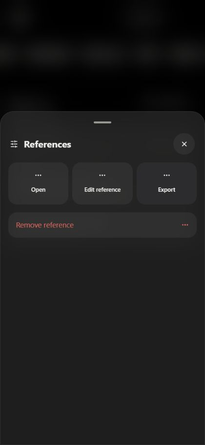

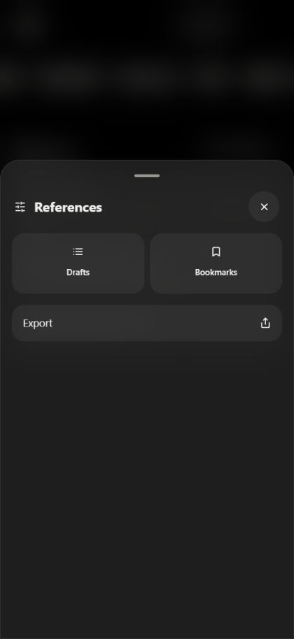

## Published and exports

The second row has zero references and no reference pill. Dates are made-on
dates (June 15, 2024 and February 10, 2023), independent of this week's publication.

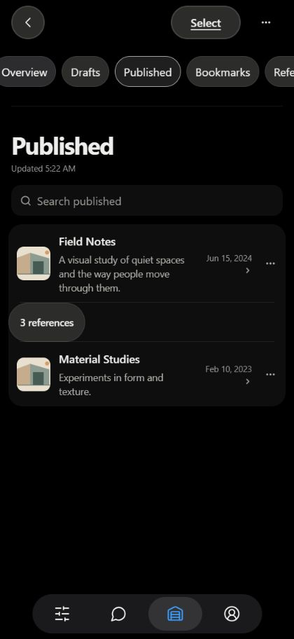

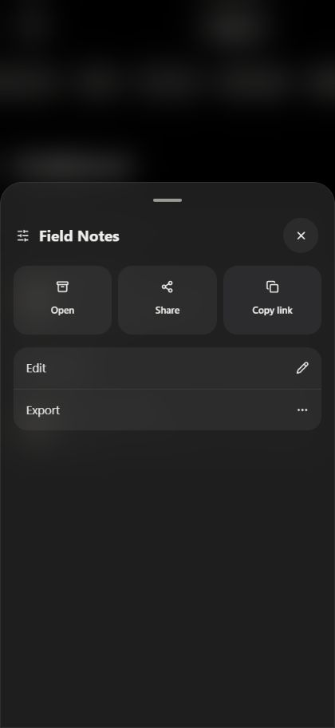

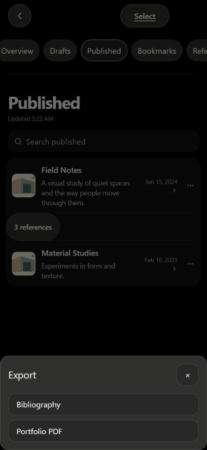

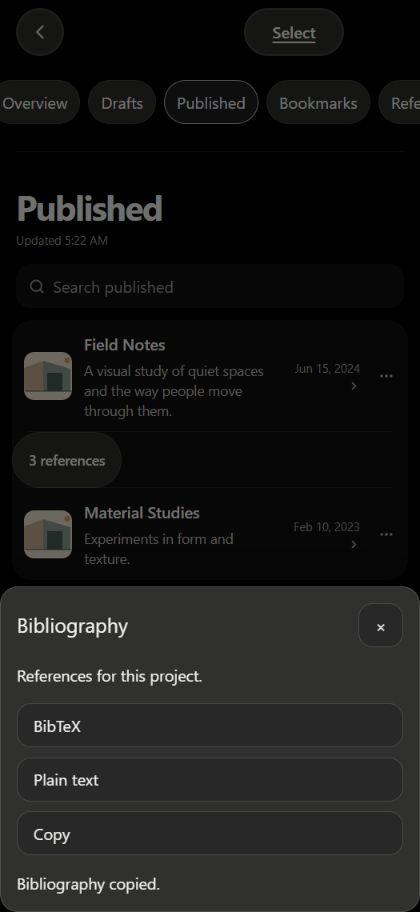

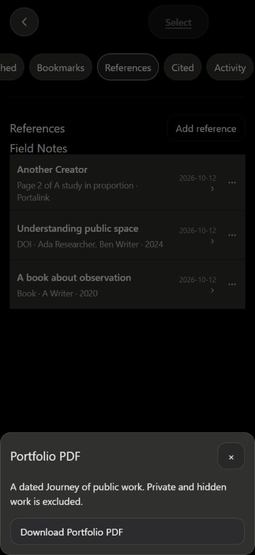

## Project references and own citation

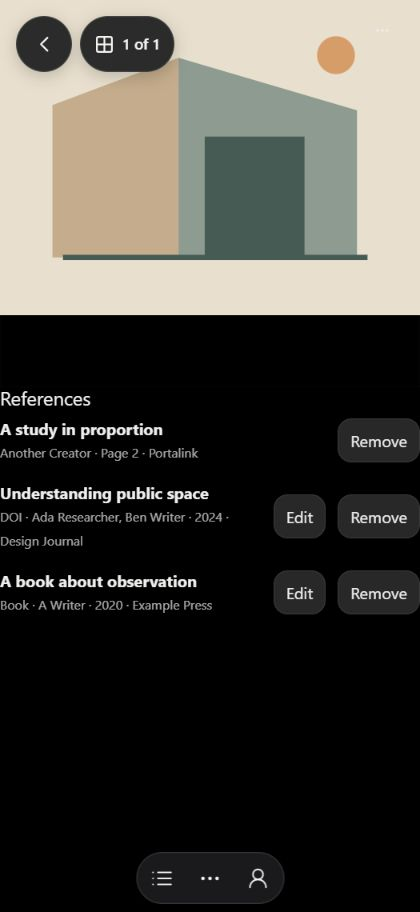

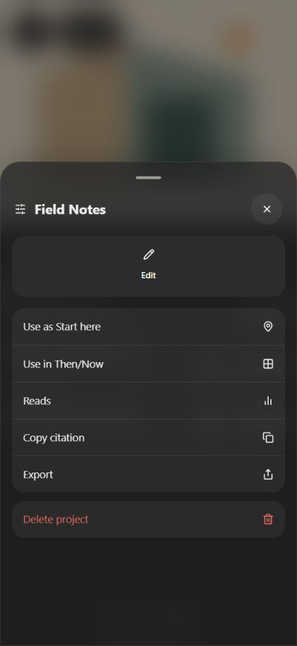

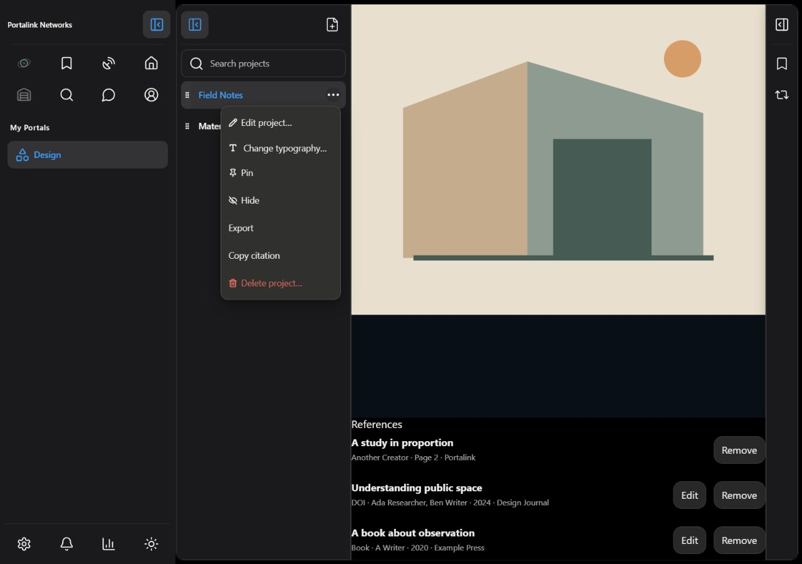

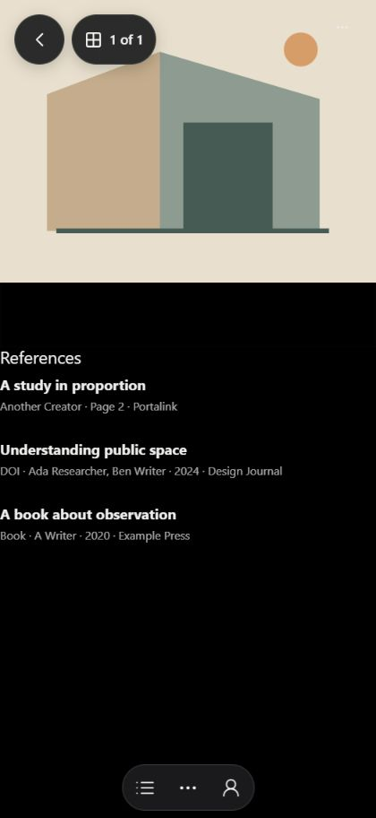

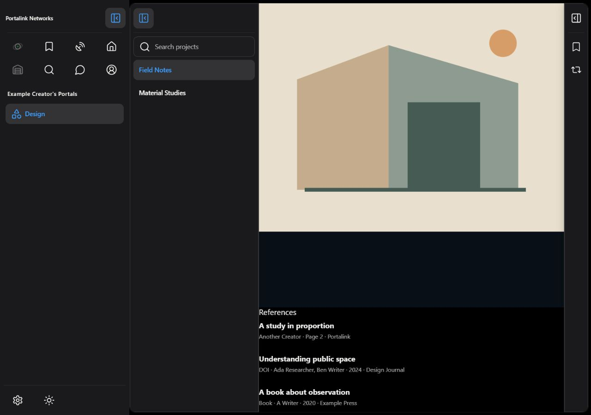

## Real generated Portfolio PDF

[Synthetic 16-project PDF](portfolio-16.pdf): eight pages, generated with the
actual Python renderer. First and last pages were rendered and inspected; all
16 projects are present. The local authenticated HTTP adapter also produced
eight pages and rejected missing authentication. The browser download used this
generated file through its synthetic transport; a hosted PDF service is pending.

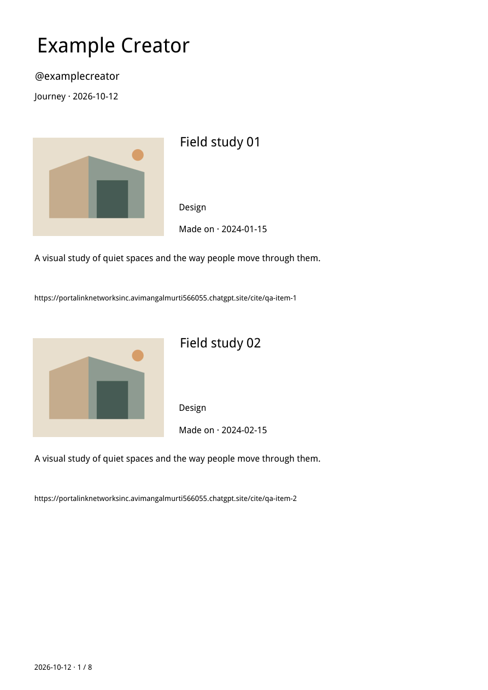

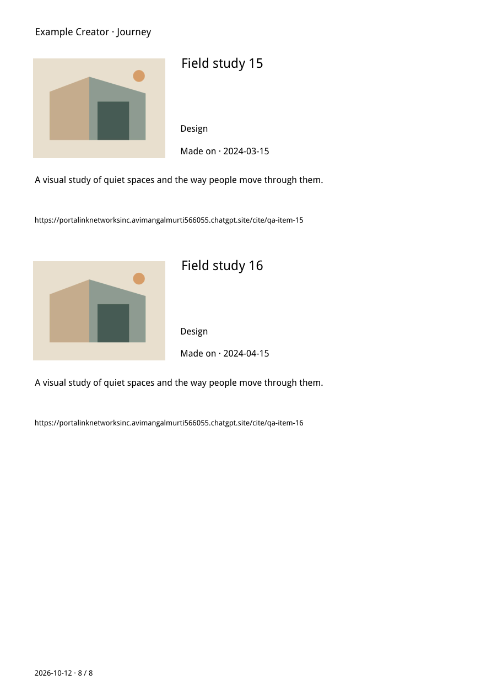
