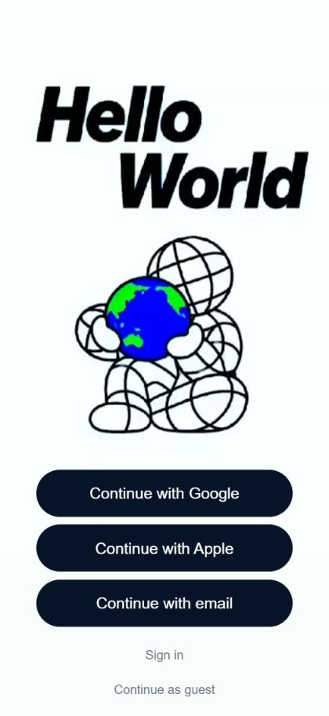
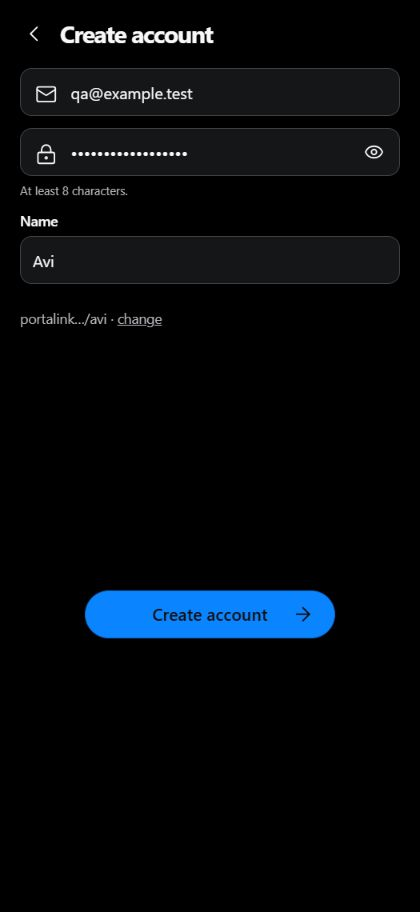
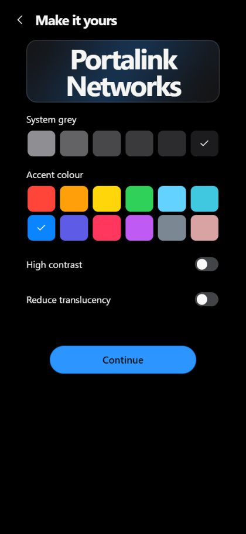
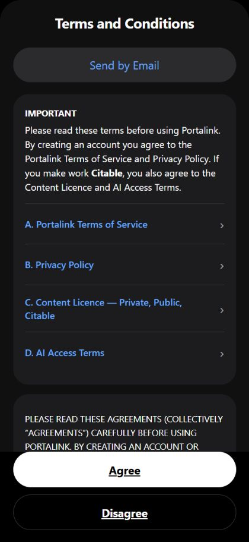
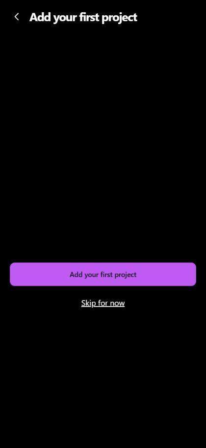
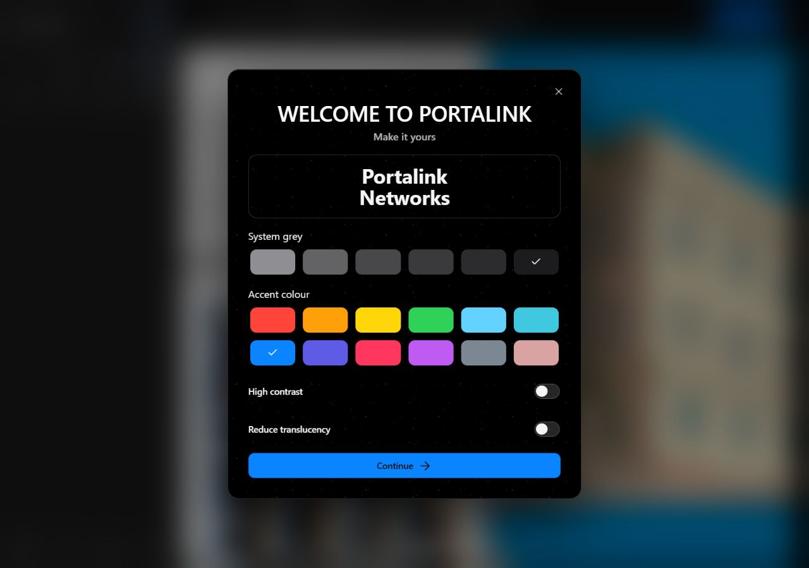
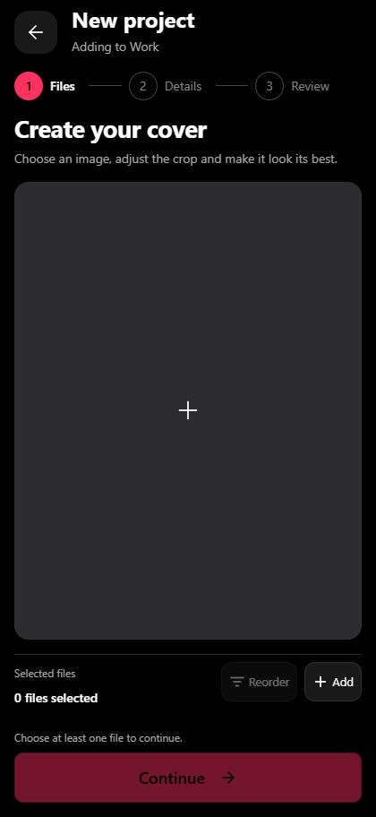

# Signup evidence

Actual app root and components with synthetic account/provider/legal services.
No real account, consent, provider or profile writes. Mobile420×912 and Web1280×900.

Email, simulated Google and simulated Apple reach the same ordered steps.
Password reveal, name-derived handle, live colour/contrast changes and Skip to
Explore were exercised. Live Supabase providers are disabled; these captures do
not establish live OAuth, email delivery, production Terms RLS or phone behavior.
