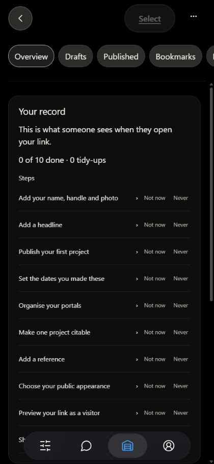
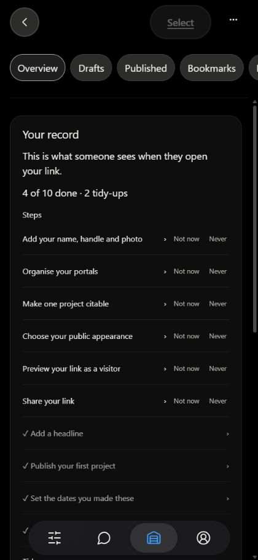
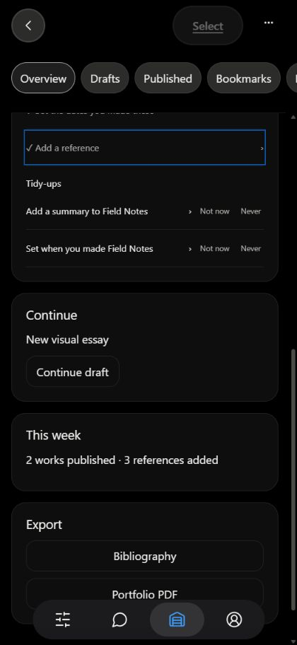
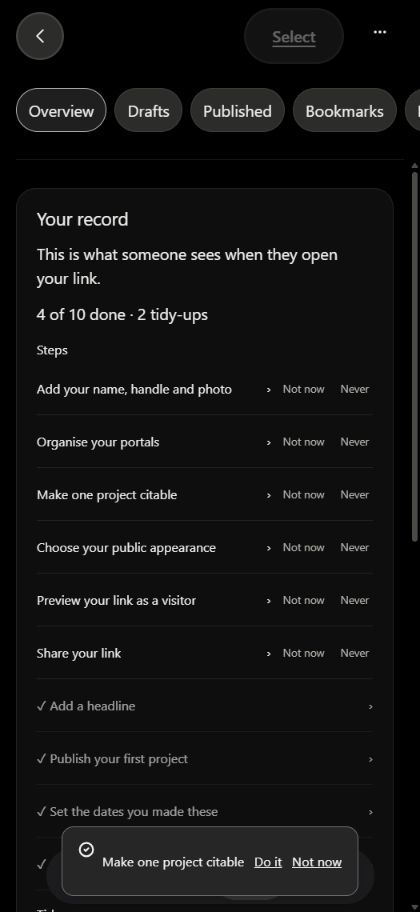
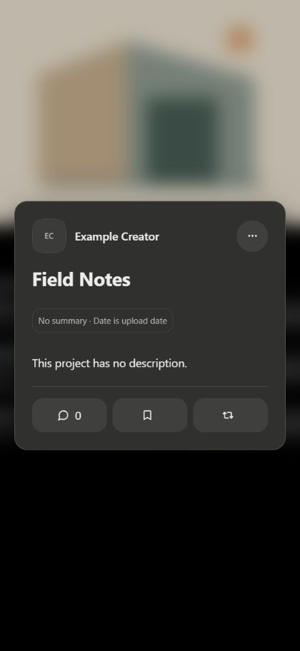
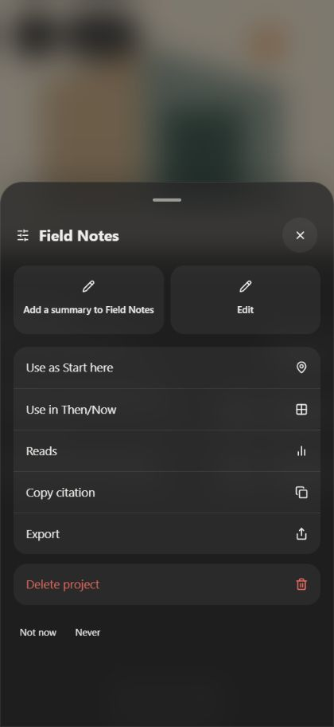
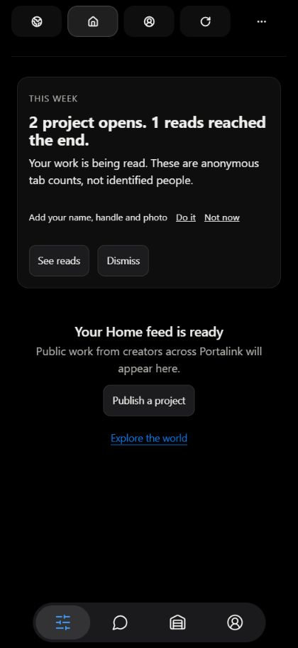
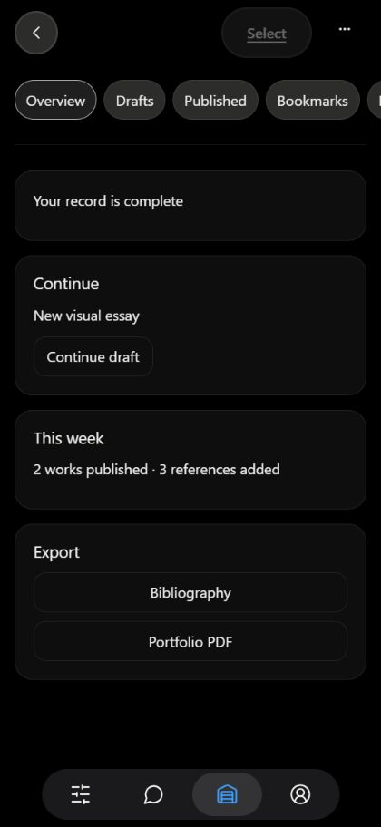

# Your record screenshots

Actual app components, local420×912 preview, synthetic services and transport. These are example accounts, not the user's live account. No production publication, account changes or SQL application was performed. Post-publish is an explicitly simulated confirmation state; its Do it action opens the real existing Access field. Summary and Made on field navigation, photo focus, snooze ordering and390px overflow were separately exercised.

The complete state uses satisfied example profile/project data and one-time events. School + city is deferred; MCP is not live; ten steps are available. Existing desktop Studio remains its development placeholder. Production-account verification, hosted job execution and physical iPhone proof remain pending approved activation.

## Fresh account

## Existing example owner's record

## Post-publish

## Project

## Returning-user Home

## Complete

