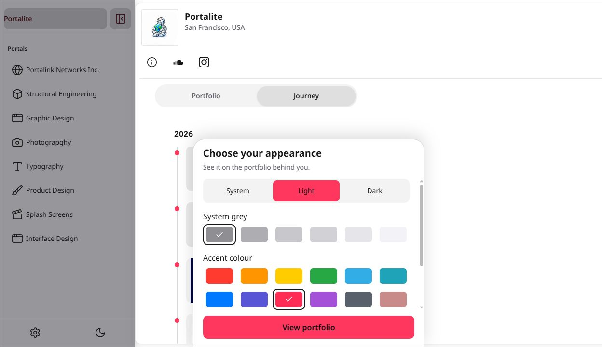
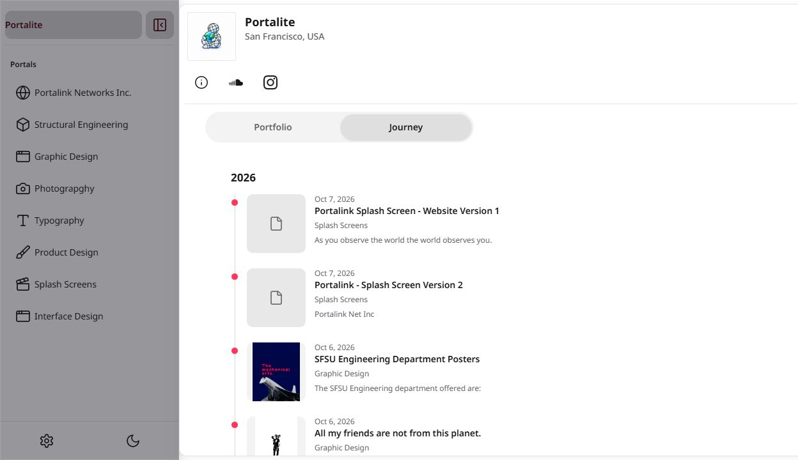
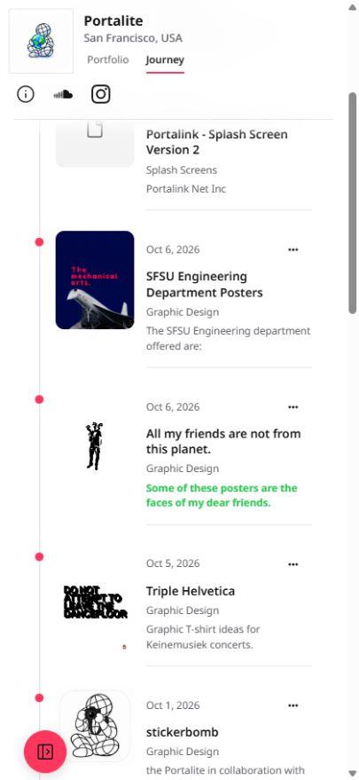

# Public visitor fixes — 7 October 2026

Unpublished task branch `codex/public-visitor-fixes`, based on main `ca9bc8bd3a0786f783e2a1ef72fa90ea71f35dff` (Sites 353 source). No SQL, signup, production content mutation, Storage change, merge or publish.

## Summary formatting and live audit

Read the real anonymous shared-profile bundle: 16 projects, 8 portals. No fixture rows. Existing summary text was not rewritten. Visible FormattedText and plainFormattedText now share formattedInline. Journey, grid captions, project descriptions, Studio secondary text and notification bodies render formatting; share-card and OG descriptions, plain-text/BibTeX citation titles strip it. Editor input remains untouched.

Exact regression input: `***{#34c759|Some of these posters are the faces of my dear friends. }***`. It renders green bold italic text and plain output is `Some of these posters are the faces of my dear friends. `.

| Live project | Audit result |
| --- | --- |
| Portalink - Splash Screen Version 2 | No editor markup found |
| Portalink Splash Screen - Website Version 1 | No editor markup found |
| SFSU Engineering Department Posters | Four bullet-list lines; handled by the shared renderer/plain formatter |
| All my friends are not from this planet. | Colour + combined emphasis (reported leak) |
| Triple Helvetica | No editor markup found |
| stickerbomb | No editor markup found |
| Analysis of a Single-Degree- of-Freedom (SDOF) StructurE | No editor markup found |
| Tribute to Helvetica | No editor markup found |
| I'm feeling font | No editor markup found |
| Paper Pens | No editor markup found |
| Wet Paint | No editor markup found |
| Plant Cell Microscope Photography | No editor markup found |
| Catalogue of Performative Poses. | No editor markup found |
| Mapped | No editor markup found |
| Quantification of Modeling Uncertainty in the Rayleigh Damping Model | No editor markup found |
| Intro to Structural Dynamics for undergraduate engineers | No editor markup found |

## Visitor opening and request evidence

Before: live Sites 353 `/portalite` redirects to `/portalite.work`; appearance modal covers the work. At the observed modal state, 15 images existed and 14 had decoded dimensions. That contradicts a claim that all covers wait for dismissing the sheet. The reported ~9-second delay was not reproduced or attributed to the modal.

After: production-connected unpublished preview opens `/portalite` directly, without importing/rendering the welcome sheet. Creator public appearance is applied silently; until the bundle arrives, the system preference supplies the initial theme. An explicit visitor choice in existing controls remains usable.

Request sequence comparison (not a measured millisecond browser waterfall):

| Stage | Before (live Sites 353) | After (local task preview) |
| --- | --- | --- |
| Address | bare → `.work` redirect | bare served directly |
| Shell/theme | saved appearance + welcome surface | system preference, then creator branding |
| Profile bundle | existing anonymous bundle path | same anonymous bundle path |
| Covers | already load behind modal; 14 observed loaded | visible work loads without blocking modal |
| Welcome chunk | imported welcome surface | removed from visitor entry |

The browser tool does not expose Resource Timing or Paint Timing (performance is unavailable in its read-only evaluation scope). Therefore an exact before/after request waterfall and first-paint milliseconds are **not verified**. Screenshots prove presentation, not network timing. No invented 9-second improvement. Local development timing cannot establish production performance; after-publish timing requires separate approval to publish.

## Redirect table

Anonymous HTML requests to the local preview, backed by live production handle RPCs:

| Request | Result | Canonical |
| --- | --- | --- |
| `/portalite` | 200 | `/portalite` |
| `/portalite.work` | 301 | `/portalite` |
| `/share/49e4e861-795a-47f2-b4a6-b071351c4d4b` | 301 | `/portalite` |
| `/sitemap.xml` | 200 | includes bare `/portalite`, public creators only |

Canonical/OG URLs and share-card/link generation use the bare handle. Stable citation URLs deliberately remain production-origin `/cite/<uuid>`; changing those to profile addresses would lose item identity. License/JSON-LD routes retain stable UUID identity. Production remains unchanged until approved publish.

## Handle creation

Root cause: createProfileHandle always sliced to seven characters and always appended a random twelve-character suffix. Neither a DB length limit nor an actual collision caused `citetes.d9ab049b2da4`.

New signup accepts validated 3–30-character lowercase public handles, checks the existing availability RPC, keeps the exact available request, and only proposes a checked suffix after a genuine collision. The form shows the final handle before a second confirmation. Availability failure prevents submission; database uniqueness still handles races. Existing creator handles are not renamed.

Four dedicated handle tests pass: exact keep (`citetest`), actual collision, invalid/overlong rejection before lookup, availability failure closed. Existing signup/onboarding tests exercise confirmation and duplicate-submission guards. No real account created for this QA.

## Checks

Matching full Node/PGlite runs: main 1,594 tests / 1,429 pass / 165 fail / 0 skip; branch 1,602 tests / 1,443 pass / 159 fail / 0 skip. All 159 failing test names also fail on main; zero new failures. Focused formatting, handles, shell appearance and Studio gestures: 21/21 pass. Historical release totals used different environment conditions; these are fresh matching runs. No tests deleted, disabled or newly skipped. Fixture import adapters were extended to execute the shared formatter rather than silently accepting arbitrary missing imports.

Typecheck passes. Lint: 0 errors, 111 warnings. Production build passes, including configured Supabase host/key checks for both main and visitor graphs. One build attempt encountered Windows EBUSY on an existing PDF worker asset; retry succeeded without source or dependency changes. Browser verification covers WEB and MOBILE preview, not physical-phone performance.
