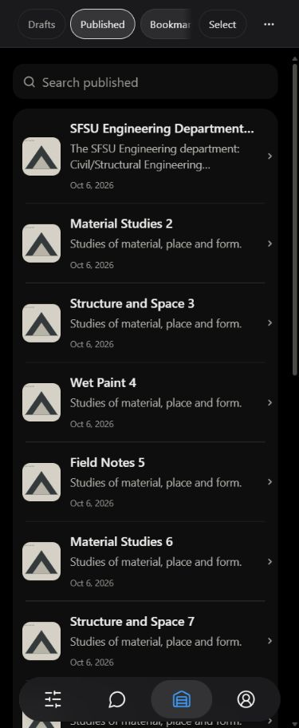
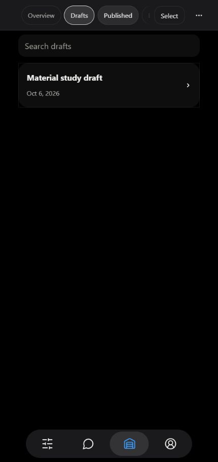
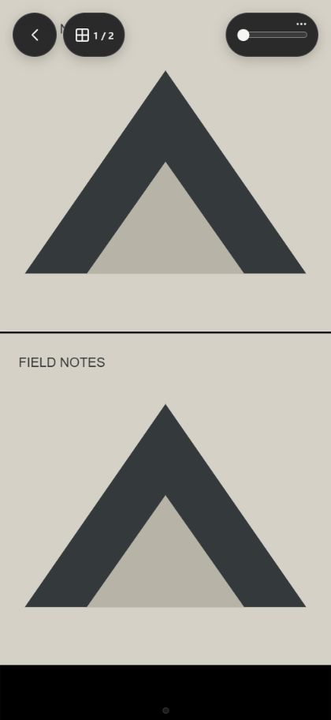
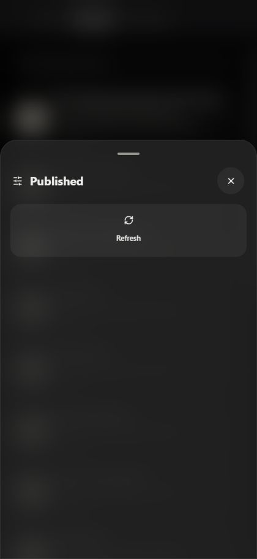
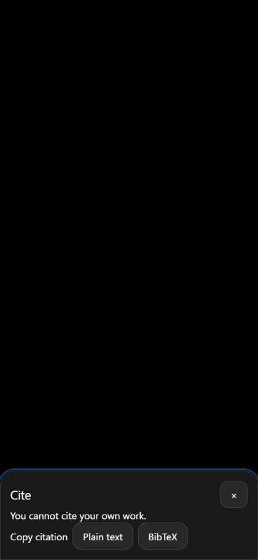
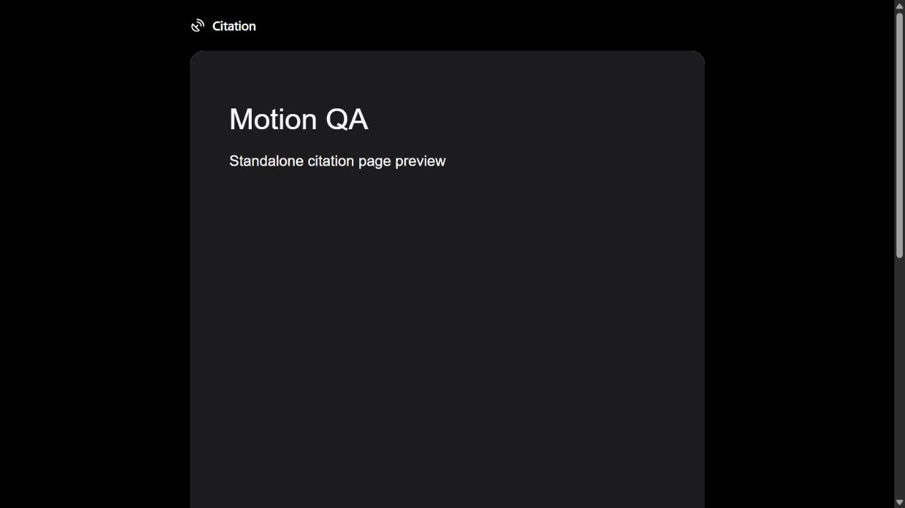
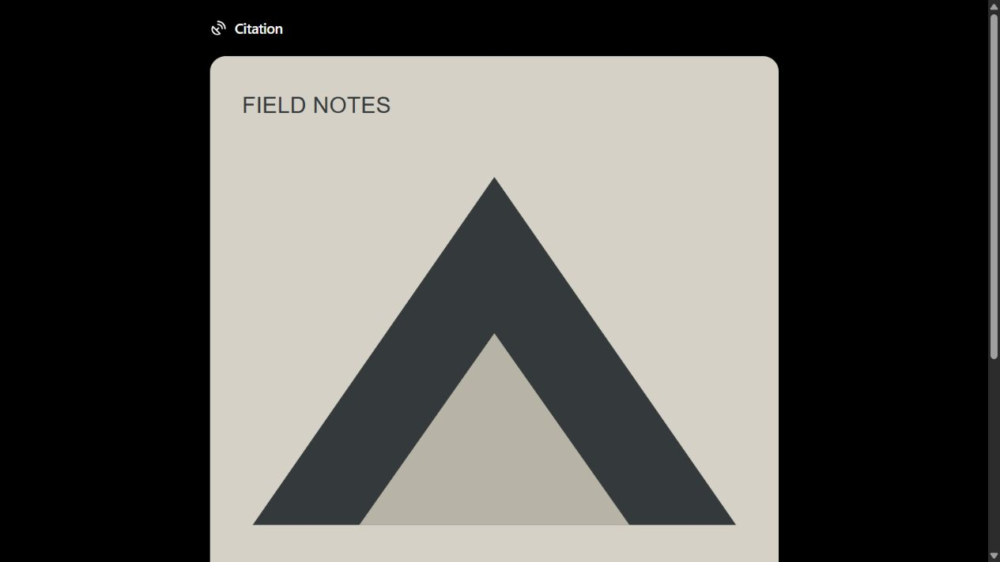
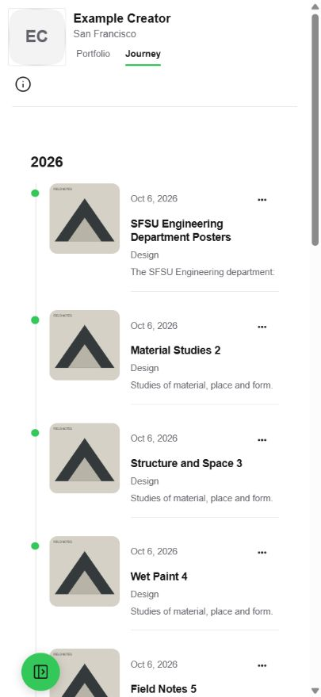
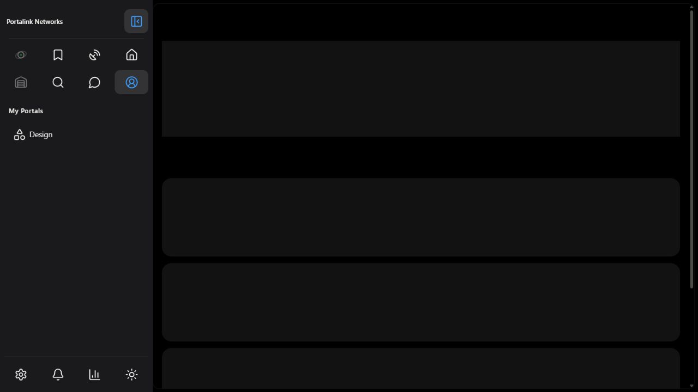

# Motion QA

Local real app components with synthetic account/services, at 127.0.0.1:5206. No real account changes or network writes. Browser preview is not physical iPhone proof.

- [20-second capture](capture-20s.gif): actual screenshots, 420 × 912, timed dock cycle, all Studio tabs, project open and app Back, Actions open/dismiss. Frame timestamps are in [capture-frames.json](capture-frames.json); source PNGs are ignored local QA artifacts. GIF timing totals 20,000 ms; no interpolated frames.
- [Browser measurements](browser-evidence.json): native dock/tab/push/back invocation, CLS 0, reader frame 65.8 ms in the capture, header top 0 and no width overflow at 375 and 430 px.
- [Reduced motion](reduced-evidence.json): preference emulated in the QA fixture; no native invocation, running animations or measured CLS. The OS-level CSS media query is additionally covered by source safeguards; physical OS preference is unverified.
- [Unsupported API](fallback-evidence.json): native API absent, reader reservation before route work, cross-fade retained, CLS 0.

Verification commands and final results are recorded in the task handoff/PR. Authored duration test does not claim control over third-party library internals or browser gesture animations. The app still has no automated browser/visual-regression runner; these measurements were taken through the browser preview.

Final frozen-source checks: typecheck passes; lint has 0 errors and 112 existing warnings; client/worker builds and configured-bundle guards pass; full Node suite 1726/1726 passes. Final focused boundaries and image handoff checks pass. The cite route stays under its 350 KB visitor gate with no editor chunks.

