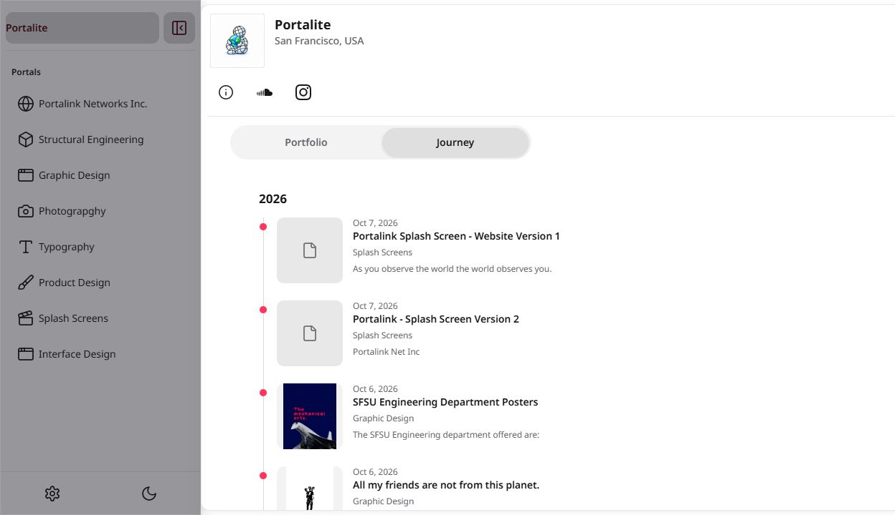
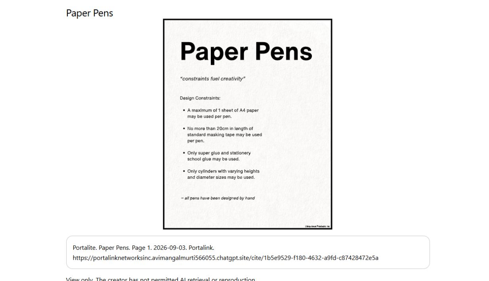

# Sites 354 release receipt — 2026-10-07

PR [#4](https://github.com/avimangalmurti-art/Portalink/pull/4) merged to main; published from exact main commit **d88f7938ffc1294c6cbf2594218504e941123e30** in isolated `logs/visitor-main-release`. Sites **354**, deployment `appgdep_6ac6f025cb7c8191b5f71bc0863fdaec`, success at `2026-10-08T01:21:52.514745+00:00`. Live host: https://portalinknetworksinc.avimangalmurti566055.chatgpt.site .

Existing ignored production `.env.local` was available via local link; no credentials printed, staged or packaged. Production build passed both VITE_SUPABASE configuration guards and configured host/key checks in main and visitor bundle graphs. Localhost library fallback/validation literals were inspected: actual router origin and Supabase auth configuration override the dormant defaults. The user explicitly accepted validation literals; no active localhost endpoint was configured. Package SHA-256 `2533616202f6c0dcfdd9ea303dfe0fd01a20e6d1f4c4a3c288179bc6b8301741`, 550 files; credential files excluded. Existing Sites worker, D1 and environment revision preserved. No SQL, Storage, account or content changes.

## Live smoke checks

| Route | Result |
| --- | --- |
| `/portalite` | 200; bare-handle canonical; work visible with no appearance dialog |
| `/portalite.work` | 301 to `/portalite` |
| `/share/49e4e861-795a-47f2-b4a6-b071351c4d4b` | 301 to `/portalite` |
| `/cite/9ae4b24a-446d-41b8-b3a9-1a035ed14fc7` | 200; actual image and production citation URL |
| `/cite/1b5e9529-f180-4632-a9fd-c87428472e5a` | 200; document page and production citation URL |

Browser DOM confirmed no appearance modal. Journey rendered the exact friends summary through emphasis and green colour (`rgb(52, 199, 89)`) rather than leaking editor syntax. The SFSU work summary rendered its formatted first paragraph correctly. Journey intentionally summarizes the first paragraph; this does not claim its full bulleted description appears there. HTTP results and browser observations establish this release smoke check, not a physical-phone/performance timing claim.

The later `codex/repeatable-suite` branch is a separate test/documentation task. It is not published by this release.
