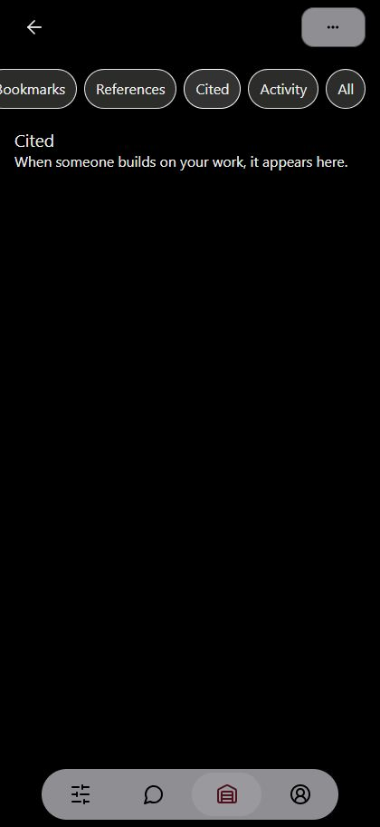

# Sites357 release receipt

Published main commit **e53e69d419e271aed78f2d6dac0b478d476ed920**, after merging PR13 and PR14. Deployment **appgdep_6ac738983b2c81919ad7305c37c32666** succeeded at 2026-10-08T06:30:59.858772+00:00. Version appgprj_6a9273ef43f8819198e0878a0020ad91~appgver_68eb6b06676c81918a8648410493867c.

Full local suite1617 passed, zero failures/skips. All five hosted checks green. Typecheck/build pass, lint0errors111existing warnings. Existing production env linked; both entry bundle guards pass. No new localhost endpoints; previously accepted dormant library defaults unchanged. Archive550files, SHA2565c8a40fd49172291b687b18893326005cb46037d41f3b6df2acb7fa87ccf83a2. Public audience/runtime2/D1 retained; no MCP, SQL, Storage or content mutation.

Live browser: Home loads; /portalite shows Journey without blocking modal; .work and UUID share aliases reach /portalite. Image UUID and page UUID citation entries show image13/Page1 and production citation URL. Signed-in empty test account at420x912: Published/Cited/References route selection changes correctly; actual empty Cited and References states load. Populated owner rows/Select and physical-phone slider/crash acceptance remain unverified. Terminal HEAD probes were blocked403; no200/301 status claim is made from those probes.

The temporary verification tab was closed and viewport reset. User's Studio tab remains on References. This receipt is documentation only and is not the deployed commit.
