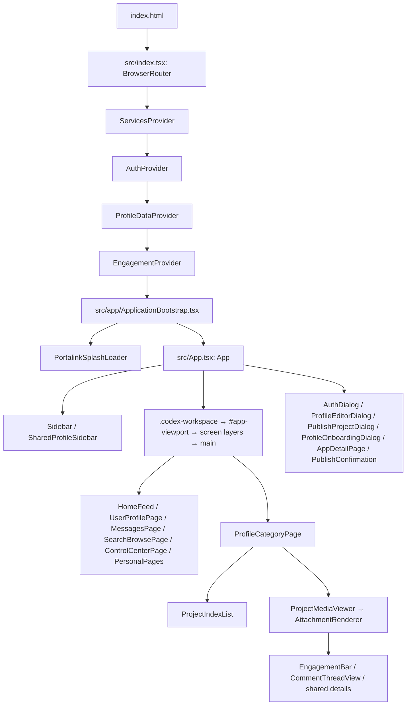

# Portalink WEB/MOBILE codebase audit

Document 03 deliverable: inspection and migration planning only.

**Recommendation:** introduce the presentation boundary inside the existing `App` composition, below its stable routing, account, data, and workflow ownership. Preserve the current WEB markup and behavior first. Introduce MOBILE navigation/layout slots incrementally around a stable content host; adapt individual features only when their intended mobile behavior is known.

**Baseline:** commit `4913393de67621ce30cafec52f8c74183e59504e`. An existing uncommitted `index.html` title edit was present and was left untouched. This audit adds only this report. No application changes, migration, deployment, account operation, browser interaction, build, or test run was performed. Findings describe inspected source, not reproduced device failures.

## A. Current stack and verification capability

| Area | Actual implementation |
| --- | --- |
| Frontend | React 18.3.1 function components and hooks, TypeScript, with a few JavaScript helpers. One client-rendered application. |
| Build | Vite 8.2.2, React plugin and Sites plugin. Browser output is `dist/client`; a second build emits the server worker at `dist/server/index.js`. See [package.json](<C:/Users/avima/OneDrive/Desktop/Portalink Platform/package.json:6>), [vite.config.ts](<C:/Users/avima/OneDrive/Desktop/Portalink Platform/vite.config.ts:6>), and [vite.worker.config.ts](<C:/Users/avima/OneDrive/Desktop/Portalink Platform/vite.worker.config.ts:7>). |
| Styling/UI | Tailwind 3.4 utilities, large global semantic-token stylesheet, feature CSS, Framer Motion, Lucide/react-icons, dnd-kit. PDF.js and Three.js support specialist media. Preserve these choices. |
| Routing | React Router 7.18.2 supplies one `BrowserRouter`. A central route table and custom `matchPath` parser select screens; there is no nested `<Routes>/<Outlet>` layout tree to duplicate. [routes.ts](<C:/Users/avima/OneDrive/Desktop/Portalink Platform/src/app/routes.ts:25>), [useAppRoute.ts](<C:/Users/avima/OneDrive/Desktop/Portalink Platform/src/app/useAppRoute.ts:107>). |
| State | React contexts and feature hooks, custom caches, browser-local preferences and session memory. No external Redux/Zustand/TanStack Query layer is declared. |
| Services | Typed injected registry, Supabase Auth/database/RPC/Storage, resumable media upload, and separate same-origin page-interaction APIs backed by the Sites worker/D1. PDF processing has a separate Python worker. |
| PWA | A standalone manifest, icons, viewport-fit, safe-area CSS, and a specialized media service worker exist. Application offline caching, install-prompt handling, and standalone-mode handling were not found. Installability has not been verified. |

The manifest at [public/site.webmanifest](<C:/Users/avima/OneDrive/Desktop/Portalink Platform/public/site.webmanifest:5>) uses `/` as its start URL and declares one existing 1254x1254 PNG for `any maskable`. Missing dedicated 192/512 entries or an explicit manifest ID do not by themselves prove installation failure.

The existing root-scope service worker is significant: [multipartMedia.ts](<C:/Users/avima/OneDrive/Desktop/Portalink Platform/src/services/supabase/multipartMedia.ts:10>) registers `/portalink-media-reader.js` at `/` and expects that exact controller. [The worker](<C:/Users/avima/OneDrive/Desktop/Portalink Platform/public/portalink-media-reader.js:3>) stores short-lived viewing metadata in IndexedDB and intercepts `/__portalink_media/`; it deliberately does not cache the application. Any later PWA worker work must coordinate this registration.

**Existing commands, inspected but not run:**

| Purpose | Command / coverage |
| --- | --- |
| Development | `npm run dev` |
| Preview built client | `npm run preview` |
| Types | `npm run typecheck` (`tsc --noEmit`) |
| Lint | `npm run lint`; existing [.eslintrc.cjs](<C:/Users/avima/OneDrive/Desktop/Portalink Platform/.eslintrc.cjs:4>) uses TypeScript and React Hooks rules. No separate format-check command found. |
| JavaScript tests | `node --test tests/*.test.mjs` as documented in README. There are 30 test files and no `npm test` script. In PowerShell, explicit file expansion can use `node --test @(rg --files tests -g '*.test.mjs')`. Use Node 22.13+ compatible with the installed build plugin. |
| Build | `npm run build`; cleans `dist`, then builds browser and worker. |
| PDF worker tests | From `workers/pdf_processor`: `python -m unittest discover -s tests -p "test_*.py"`. |

[CI](<C:/Users/avima/OneDrive/Desktop/Portalink Platform/.github/workflows/quality.yml:21>) runs typecheck, lint, build, and the separate Python job. It currently omits the JavaScript test suite. Existing tests include simulated viewport/keyboard geometry ([dialog-viewport](<C:/Users/avima/OneDrive/Desktop/Portalink Platform/tests/dialog-viewport.test.mjs:17>)), panel allocation and compact navigation ([ui-consistency](<C:/Users/avima/OneDrive/Desktop/Portalink Platform/tests/ui-consistency.test.mjs:18>)), and comments/toolbar geometry. They use Node, mocks, VM/static markup, arithmetic, and source assertions. No configured browser E2E runner or screenshot baseline was found. These checks cannot establish rendered WEB/MOBILE equivalence.

## B. Current WEB composition

The actual root-to-screen path is:



Provider mounting is in [src/index.tsx](<C:/Users/avima/OneDrive/Desktop/Portalink Platform/src/index.tsx:19>). [ApplicationBootstrap](<C:/Users/avima/OneDrive/Desktop/Portalink Platform/src/app/ApplicationBootstrap.tsx:38>) waits for auth readiness and handles public-view continuity, including the recovery-form exception. It mounts `App` once authentication initialization settles.

[App](<C:/Users/avima/OneDrive/Desktop/Portalink Platform/src/App.tsx:1143>) renders the themed root, persistent navigation, workspace, and global dialogs. Its screen selection is at [App.tsx:1068](<C:/Users/avima/OneDrive/Desktop/Portalink Platform/src/App.tsx:1068>). Messages, search, and appearance are lazy loaded. Personal account pages include saved, notifications/activity, and insights; Portals and Studio currently use `FeatureInDesignPage`.

Main navigation receives profile records and one `useCategoryManagement` instance from `App`, then derives category order, hidden state, icons, and owner actions in [Sidebar.tsx](<C:/Users/avima/OneDrive/Desktop/Portalink Platform/src/components/Sidebar.tsx:793>). Public navigation instead receives the public creator profile through [SharedProfileSidebar](<C:/Users/avima/OneDrive/Desktop/Portalink Platform/src/components/profile/SharedProfileSidebar.tsx:85>). This public/account distinction is independent of WEB/MOBILE.

Routes encode profile/category/project IDs and messaging/search parameters. [Protected route kinds](<C:/Users/avima/OneDrive/Desktop/Portalink Platform/src/app/useAppRoute.ts:89>) are gated by [App](<C:/Users/avima/OneDrive/Desktop/Portalink Platform/src/App.tsx:763>), with pending destinations preserved through sign-in/onboarding. Owner/visitor/public permissions remain enforced by services. Hosted deep links fall back to the application through [sites-worker.ts](<C:/Users/avima/OneDrive/Desktop/Portalink Platform/src/sites-worker.ts:304>).

Overlays use several hosts. [ModalPortal](<C:/Users/avima/OneDrive/Desktop/Portalink Platform/src/components/ui/ModalPortal.tsx:10>) targets `.app-shell`; sidebar menus also portal to `body`. [MediaCommentsPopover](<C:/Users/avima/OneDrive/Desktop/Portalink Platform/src/features/media-interactions/MediaCommentsPopover.tsx:5>) prioritizes the native fullscreen element, then the app shell. Preserve host identity, inherited tokens, focus, and stacking behavior during extraction.

## C. Shared core and responsibility classification

| Classification | Existing modules and treatment |
| --- | --- |
| SHARED CORE | [ServicesContext](<C:/Users/avima/OneDrive/Desktop/Portalink Platform/src/contexts/ServicesContext.tsx:10>), [service registry](<C:/Users/avima/OneDrive/Desktop/Portalink Platform/src/services/index.ts:37>), service interfaces, Supabase clients, domain models, permissions and validation. Preserve one implementation. |
| SHARED CORE | [ProfileDataContext](<C:/Users/avima/OneDrive/Desktop/Portalink Platform/src/contexts/ProfileDataContext.tsx:52>) cache/deduplication/invalidation; [EngagementContext](<C:/Users/avima/OneDrive/Desktop/Portalink Platform/src/contexts/EngagementContext.tsx:119>) optimistic updates and rollback; feed ranking, account-scoped queries, project resolution, upload/publish transactions, messaging mutations and reconciliation. |
| SHARED UI CANDIDATE | Semantic Button/IconButton/StateViews, responsive images/covers, crop controls, measured element size, collision-aware menu positioning, modal focus/viewport helpers, attachment renderers. Reuse after checking their global CSS dependencies. |
| WEB PRESENTATION | Persistent navigation and resizing, project index/response allocation, desktop density, workspace scroll/transition policy. These are intentional existing behavior, not defects. |
| MOBILE ADAPTATION CANDIDATE | Navigation presentation, profile hover details/menus, file ordering, project rails/toolbars, message composer and local overlays. Existing compact behavior can be retained until a deliberate design decision replaces it. |
| MIXED RESPONSIBILITY | [AuthContext](<C:/Users/avima/OneDrive/Desktop/Portalink Platform/src/contexts/AuthContext.tsx:111>) mixes identity with sheet/focus behavior; `usePublishProject` and `useProjectManagement` mix transaction state with editor steps; `useMessaging` combines shared reconciliation with visibility/navigation integration. Split only the parts a concrete adaptation requires. |
| UNDECIDED | Platform availability for specialist authoring, typography/verification tools, geography/live surfaces, and future Studio/Portals capabilities. Folder names and existing placeholders do not establish mobile availability. |

Keep creator branding and public visibility shared. Browser-only APIs do not automatically make a module WEB-only: MOBILE is also a browser/PWA experience. Existing visitor light/dark overrides remain per public profile.

One transport exception matters: [mediaInteractionRequest.ts](<C:/Users/avima/OneDrive/Desktop/Portalink Platform/src/features/media-interactions/mediaInteractionRequest.ts:1>) calls same-origin worker APIs directly rather than `ServicesContext`. Preserve this shared path. Moving it into the registry is not required for presentation separation. Page-level and project-level engagement also have different current guest-action replay behavior; do not standardize that as migration cleanup.

## D. Recommended presentation boundary

**Start inside `App`, at its render composition, rather than above `ApplicationBootstrap` or the providers.** Keep route parsing, auth/deferred intents, profile resolution, category management, appearance persistence, and active workflows stable.

Introduce only enough separation for navigation/layout to vary. Proposed names such as `WebNavigation`, `MobileNavigation`, or `WorkspaceHost` are future designations, not existing files. The initial content host and global dialog owners should retain their React identity and tree position. Switch presentation slots, not two complete stateful applications.

| Option | Assessment |
| --- | --- |
| Two independent root apps/route trees | Reject: duplicates coordination and makes state, auth, and deep-link divergence likely. |
| WEB/MOBILE shell selected below providers | Viable only with stable feature/controller ownership. Merely sharing root providers does not protect local drafts/media from remounting. |
| Shared route/feature layer with platform navigation/layout slots | Recommended first seam: preserves existing routing and ongoing work while allowing independently editable chrome. |
| Feature-level adaptation alone | Useful afterward, but insufficient to separate persistent desktop navigation from MOBILE presentation. |

Reuse the existing [639px compact-navigation boundary](<C:/Users/avima/OneDrive/Desktop/Portalink Platform/src/hooks/useCompactNavigation.ts:7>) as an initial compatibility reference, not a claim that every phone is under 640px. Keep container-based panel allocation distinct from application presentation selection. Centralize any new selection rule once; use viewport/capabilities, not device-brand detection. A development-only per-preview override can later make both presentations inspectable. Tablet/landscape behavior requires verification before treating that threshold as a final product policy.

Keep tokens and appearance resolution common. Isolate WEB geometry/density rules as necessary, preserving their current cascade order and specificity. Avoid adding a platform abstraction around unchanged components or moving all feature hooks into a new global store.

## E. Concrete desktop assumptions and existing safeguards

| Area | Finding, existing safeguard, and migration implication |
| --- | --- |
| Navigation widths | [Sidebar](<C:/Users/avima/OneDrive/Desktop/Portalink Platform/src/components/Sidebar.tsx:753>) uses 184–360px; shared navigation uses 180–360px. Defaults and saved width are distinct. Compact navigation already collapses to a 48/52px rail without overwriting desktop preferences. Mobile expansion/resize behavior needs deliberate treatment. |
| Project workspace | [projectPanelLayout.ts](<C:/Users/avima/OneDrive/Desktop/Portalink Platform/src/utils/projectPanelLayout.ts:3>) budgets 52px rails, a 320px work target and 220px index minimum. It already closes siblings or shows a single selected panel. Preserve this WEB policy; MOBILE need not display all rails together. |
| Scroll/height model | [App scroll memory](<C:/Users/avima/OneDrive/Desktop/Portalink Platform/src/App.tsx:521>), [absolute screen layers](<C:/Users/avima/OneDrive/Desktop/Portalink Platform/src/app/screenTransitions.css:12>), project index, media viewport and response rail own distinct scroll areas. Root safe areas and `100dvh`/`100svh` exist at [index.css:3625](<C:/Users/avima/OneDrive/Desktop/Portalink Platform/src/index.css:3625>). Preserve scroll ownership; device keyboard/panning remains unverified. |
| Profile tiles/menus | [UserProfilePage](<C:/Users/avima/OneDrive/Desktop/Portalink Platform/src/components/UserProfilePage.tsx:278>) reveals details and owner controls on hover/focus. Fixed-width local menus at lines 295, 557 and 636 lack the shared viewport-clamping helper. Touch discoverability and containment are adaptation candidates. The flowing profile and measured adaptive image wall already help narrow layouts. |
| Publishing | [ProjectFormDialog](<C:/Users/avima/OneDrive/Desktop/Portalink Platform/src/components/publishing/ProjectFormDialog.tsx:23>) already follows VisualViewport and modal focus; its CSS bounds the form and separates scrolling content/actions. File picking has a visible alternative to dropping. [MediaPicker ordering](<C:/Users/avima/OneDrive/Desktop/Portalink Platform/src/components/publishing/MediaPicker.tsx:330>) relies on HTML drag/drop with keyboard-only-revealed Up/Down alternatives: a touch affordance is still needed if mobile ordering is included. |
| Messages | [MessagesPage](<C:/Users/avima/OneDrive/Desktop/Portalink Platform/src/components/MessagesPage.tsx:256>) already alternates list/thread below `lg`; desktop shows both. There is a visible send button. Composer Enter behavior and contained report/confirmation overlays need keyboard/short-viewport review; they do not use the publishing VisualViewport helper. |
| Media interaction | Image/PDF viewers already support pinch, swipe, double-tap and keyboard actions. [useSinglePageZoom](<C:/Users/avima/OneDrive/Desktop/Portalink Platform/src/components/media/useSinglePageZoom.ts:151>) implements pinch; [hover-none CSS](<C:/Users/avima/OneDrive/Desktop/Portalink Platform/src/index.css:5382>) keeps engagement controls visible on touch. Preserve these capabilities; adapt surrounding toolbars as needed. |
| Global CSS | [Role-based material rules](<C:/Users/avima/OneDrive/Desktop/Portalink Platform/src/index.css:2663>), [dense panel typography](<C:/Users/avima/OneDrive/Desktop/Portalink Platform/src/index.css:4266>) and [codex-shell controls](<C:/Users/avima/OneDrive/Desktop/Portalink Platform/src/index.css:4698>) use broad selectors and `!important`. Reusing these classes can unintentionally carry desktop density into MOBILE. Conversely, global fixes could alter WEB. |

## F. Regression-risk register

| Priority / risk | Evidence | Protection before migration proceeds |
| --- | --- | --- |
| High: WEB geometry/CSS regression | `App.tsx:1143`, `index.css`, `screenTransitions.css`, Sidebar and panel allocator | Preserve current WEB DOM/classes and preference keys; compare expanded/collapsed rails, light/dark, public/account profiles, scroll and overlays at representative desktop widths. |
| High: lost drafts/uploads on resize | [PublishProjectDialog:36](<C:/Users/avima/OneDrive/Desktop/Portalink Platform/src/features/publishing/PublishProjectDialog.tsx:36>) owns its hook; [useMediaPreparation:73](<C:/Users/avima/OneDrive/Desktop/Portalink Platform/src/features/publishing/useMediaPreparation.ts:73>) revokes preview URLs on unmount; [MessagesPage:76](<C:/Users/avima/OneDrive/Desktop/Portalink Platform/src/components/MessagesPage.tsx:76>) keeps selected `File[]` in component state | Keep controller owners mounted across presentation switches. Test a partially completed form, selected attachment, in-flight upload and retry state across threshold/orientation changes. Lift only required state before replacing a feature subtree. |
| High: duplicate/reset shared state | `index.tsx:19`, Auth/ProfileData/Engagement providers, `useMessaging` subscriptions | Keep one provider/router instance and one active feature controller; do not mount both complete apps and CSS-hide one. Check subscription/mutation counts and cache continuity. |
| High: routing/auth/public access changes | `ApplicationBootstrap.tsx:38`, `useAppRoute.ts`, `App.tsx:670` and `:763` | Verify pasted project/share URLs, search/message queries, Back/Forward, guest gating, onboarding continuation, password recovery and sign-out. Preserve public-vs-account restrictions independently of platform. |
| High: account-sensitive cache assumptions | `ProfileDataContext.tsx:53` caches by profile ID; [contentServices.ts:421](<C:/Users/avima/OneDrive/Desktop/Portalink Platform/src/services/supabase/contentServices.ts:421>) filters returned profile content by viewer | Establish owner-to-guest/account-switch baseline before changing provider ownership. No explicit auth-triggered cache clear was found in that provider/root path. This requires a targeted check; this audit does not establish an observed disclosure or authorize a speculative fix. |
| High: PWA breaks large-file viewing | Root-scope media worker and exact controller expectation | Preserve registration, path, control lifecycle and signed/range media delivery. Any future install/offline work must be coordinated rather than registering a competing root worker. Test over trusted HTTPS. |
| Medium: playback/scroll continuity lost | `ProjectMediaViewer.tsx:132`, [viewerMemory.ts](<C:/Users/avima/OneDrive/Desktop/Portalink Platform/src/components/media/viewerMemory.ts:1>), `App.tsx:1065` | Preserve media element identity and category transition keys. Saved page/zoom/scroll memory does not preserve live audio/video playback. Check project changes, return navigation and resizing. |
| Medium: overlay clipping/focus/theme leakage | `ModalPortal.tsx:12`, `MediaCommentsPopover.tsx:5`, body-portalled menus and App theme effects | Retain one stable theme/portal host, fullscreen-aware positioning, focus restoration and keyboard viewport behavior. Check short screens and open overlays during resize. |
| Medium: misleading baseline/documentation | [HANDOFF:13](<C:/Users/avima/OneDrive/Desktop/Portalink Platform/src/HANDOFF.md:13>) says there is no backend; [README:45](<C:/Users/avima/OneDrive/Desktop/Portalink Platform/README.md:45>) describes the superseded unsafe deletion flow | Treat inspected code/current safeguards as authoritative. Do not execute the stale account-deletion setup instructions. Refresh these documents only in an explicitly scoped later step. |

Account deletion remains hard-disabled in [client.ts:105](<C:/Users/avima/OneDrive/Desktop/Portalink Platform/src/services/supabase/client.ts:105>) and the [delete-account endpoint](<C:/Users/avima/OneDrive/Desktop/Portalink Platform/supabase/functions/delete-account/index.ts:1>). Pending replacement SQL/worker work is outside this migration. No release gate may be enabled by WEB/MOBILE work.

## G. Smallest ordered migration sequence

These are proposed next-stage actions, not actions performed in this audit.

| Step | Narrow change | Verification and stop condition |
| --- | --- | --- |
| 1. Establish baseline | Preserve the exact reviewed source and existing user edits; record representative WEB states and run available checks. Encode Documents 01/02 in persistent instructions only when the next implementation stage authorizes it. | Identify pre-existing failures separately. Stop before structural edits if routing/state/WEB baseline is unresolved. |
| 2. Isolate WEB presentation first | Extract only the necessary navigation/layout composition from `App`; keep current WEB markup, classes, content host, provider tree and workflow ownership intact. | Same screens, URLs, geometry, scroll, overlays and feature identities. Stop and correct any extraction regression before adding MOBILE selection. |
| 3. Add one presentation selector | Reuse the existing compact rule as a compatibility starting point; distinguish presentation from container sizing and input capability. Provide a development-only way to select each experience per preview if needed. | Check explicit WEB/MOBILE selection and threshold transitions. Stop if selection changes URLs, services, account permissions or saved desktop widths. |
| 4. Introduce minimal MOBILE slots | Add only enough mobile shell composition to expose the shared content region and existing compact behavior. No invented navigation system, broad screen redesign or assumed parity. | One router/provider chain, one active controller per feature, stable content and dialog owners. Stop before introducing product design beyond the structural proof. |
| 5. Prove state and navigation continuity | Exercise draft/upload/attachment retention, playback, auth recovery, public links, Back/Forward and shared mutations across viewport changes. Add only focused regression coverage where existing checks cannot prove these boundaries. | Stop if work is lost, APIs duplicate, protected content becomes visible, or history/recovery changes. Avoid real destructive account/storage tests. |
| 6. Verify WEB and shared infrastructure | Repeat representative WEB comparison, relevant type/lint/test/build checks and HTTPS media-worker checks. Inspect both presentation paths. | WEB remains consistent with baseline; shared logic remains singular. Do not claim device or visual verification from source assertions alone. |
| 7. Enable side-by-side previews and stop | Use the same dev server/source in desktop and phone-sized windows. Provide optional real-device HTTPS preview for keyboard, safe areas, touch, installed mode and media. | Shared changes propagate intentionally; scoped changes remain isolated. Hand control back for iterative MOBILE design. |

The ordering deliberately preserves/extracts WEB before making MOBILE selection active: the current `App` combines too much lifecycle-sensitive state to safely replace it with two root apps in one step. A new router, state library, UI kit or copied feature tree is unnecessary.

**Local preview procedure for a later verification stage:** the existing environment may point at live services. For isolated layout work, use a dedicated PowerShell terminal with process-only overrides, leaving `.env.local` untouched:

```powershell
$env:VITE_RUNTIME_MODE = 'prototype'
$env:VITE_SUPABASE_URL = 'https://YOUR_PROJECT.supabase.co'
$env:VITE_SUPABASE_PUBLISHABLE_KEY = 'YOUR_PUBLISHABLE_KEY'
npm run dev -- --host 127.0.0.1 --port 5173 --strictPort
```

Open the same `http://127.0.0.1:5173/` server in separate desktop/phone-sized previews. Do not start another server if a suitable one already exists. Prototype mode alone does not disable configured Supabase services; [service selection](<C:/Users/avima/OneDrive/Desktop/Portalink Platform/src/services/index.ts:40>) checks configuration separately. These overrides deliberately select local services and therefore cannot verify real recovery, messaging, or worker-backed page interactions. Those need an appropriate isolated backend/worker environment.

For a physical phone, an intentionally LAN-accessible server can use `--host 0.0.0.0` and the computer's trusted-LAN address. Raw LAN HTTP is only suitable for initial layout inspection; the media worker and installation checks require a secure context. No server was started or exposed for this audit.

## H. Open product decisions for the later design stage

No product answer is needed to complete this audit. Retain these decisions for the relevant feature's design stage:

- Which capabilities enter the initial MOBILE experience, and which are deferred or deliberately platform-only. Do not infer availability from the desktop menu or an unfinished route.
- Whether specialist authoring, typography, verification, rich file management and globe/live interactions are shared, adapted, or WEB-only. Their underlying data/services can remain shared regardless.
- How tablets, large phones, landscape and mixed touch/pointer devices choose a presentation. Existing 639px and `lg` breakpoints describe current component behavior, not a settled product-wide policy.
- Whether MOBILE includes installation/offline-specific capabilities beyond the existing manifest and media reader. Offline content and background work require separate product scope.
- Whether future presentation preferences are device/platform-local. Preserve existing creator colors and per-public-profile visitor light/dark behavior; those decisions are already established.

Final mobile navigation, colors, gestures and individual screen redesigns are intentionally left for iterative design. This audit is complete; implementation waits for review and the next document or explicit instruction.
